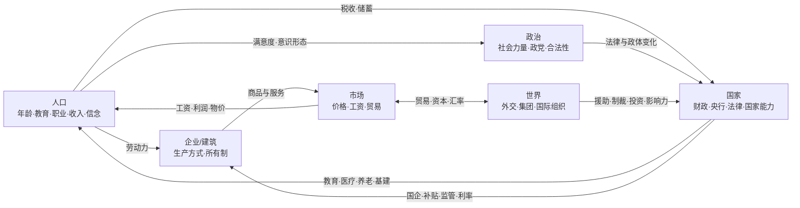

# 《战后百年》游戏设计文档（GDD）

> 版本 v0.1 · 草案，供讨论。文中所有数值都是占位，需要在原型中验证。
> 暂定名：《战后百年》（Postwar Century）。

---

## 0. 一句话概念

带领任意一个国家，从 **1946 年**走到 **2045 年**。你不是将军，而是国家的总设计师：建什么工厂、印多少钱、和谁做生意、给谁投票权、让孩子进学校还是下田——然后看着这些决定在几十年后开花结果，或者反噬自己。

在核威慑的阴影下，大国之间几乎无法再用全面战争决胜，竞争的战场转移到了**工厂、货币、选票、援助与思想**。这就是本作"重经济、人口、政治与外交，轻军事"的世界观依据：冷战之所以"冷"，本身就是游戏机制（见 11.5）。

## 1. 设计支柱

| # | 支柱 | 含义 | 每个新机制都要回答的问题 |
|---|---|---|---|
| 1 | **经济是主角** | 几乎所有系统都通过经济相连；玩家的主要工具是政策，不是军队 | 它是否通过经济与其他系统相连？ |
| 2 | **人口是活的** | 人口有年龄、教育、职业、收入和信念；会出生、老去、迁徙、转行、改变立场 | 玩家能否在人口数据里"看见"它的后果？ |
| 3 | **政治是约束** | 经济上最优的政策常常在政治上不可行；改革需要联盟、时机与代价 | 谁会受益？谁会受损？他们会怎么反应？ |
| 4 | **外交是筹码，不是战争** | 影响力来自贸易依赖、援助、投资、货币、制度与吸引力 | 不开一枪能否达成目标？代价是什么？ |
| 5 | **百年长弧** | 慢变量最重要：人口结构、教育、技术、债务、制度、气候。1960 年的决定在 2030 年回响 | 它的后果是否会延迟出现？ |
| 6 | **涌现而非剧本** | 历史是"压力 + 条件"，不是按日期触发的剧本；2026 年以后完全由模拟决定 | 如果条件不同，这件事还会不会发生？ |

贯穿性原则：**体制无绝对优劣**。计划经济、市场经济、福利国家、发展型国家、威权、民主……各有适用条件与失败模式。游戏只模拟机制与权衡，不预设"正确答案"。

## 2. 不做什么

- 不做部队、前线、将领和战斗操作；战争被抽象为危机升级与冲突结算（见 11.5、11.6）。
- 不模拟单个企业或单个人；人口以"群体（Pop）"为单位。
- 不做 3D 城市建造。
- 2026 年以后不写任何剧本化事件。
- 首个版本不做联机。

## 3. 与《维多利亚3》的关系

| | 内容 |
|---|---|
| **继承** | "人口（Pop）→ 建筑/企业 → 市场 → 利益集团 → 法律"的核心循环；生产方式；以经济与社会为主的大战略节奏 |
| **改变** | 战争：从核心手段变为被核威慑压制的**危机升级阶梯**与**抽象冲突**。科技：从以本国研究为主的科技树，变为**全球技术前沿 + 追赶与扩散**（教育、开放与外资决定追赶速度）。政体：从固定类型变为**多个制度维度的组合** |
| **新增** | 货币、央行、通胀、汇率与国际收支；主权债务与国际救助；带**年龄结构**的人口（婴儿潮、老龄化、养老金）；教育与人力资本管道；服务业、住房与非正规经济；能源转型与气候；国际组织与集团；软实力；媒体与信息环境；殖民地独立与新国家 |

## 4. 时间、地图与规模

- **开局**：1946 年 1 月 1 日（战后第一个新年）。**结束**：2045 年 12 月 31 日（二战结束 100 周年）。
- **时钟**：界面按"日"推进；**每周**结算生产、市场与贸易；**每月**结算就业流动、政治与外交；**每年**结算人口队列（出生、死亡、年龄推移）、教育升级、技术扩散与气候。整局约 5,200 个周回合。
- **地图**：约 1,000—1,500 个**地区**，以一级行政区为基础合并或拆分；在 1946 年的分界线（如德国占领区、朝鲜半岛三八线）处按需细分。地区是人口、建筑、资源与归属的基本单位，同一时间只属于一个政治实体。
- **政治实体**：开局约 70 个主权国家，加上大量殖民地、托管地与占领区（作为附属实体存在）。随着去殖民化，国家数量逐步增加到近 200 个。
- **可玩国家**：任何国家，包括游戏中途独立的新国家（独立时可以切换过去）。
- **单局时长目标**：完整百年约 30—60 小时。
- **更多开局**（后期内容）：1962、1979、1991、2008、2026。每个开局都需要一整套开局数据，所以首个版本只做 1946。

## 5. 核心循环



**玩家的一年在做什么：**

1. **看**：宏观仪表盘（增长、通胀、失业、财政、国际收支、汇率、民意、合法性）与地图模式。
2. **定方向**：选择发展战略——进口替代、出口导向、资源立国、计划工业化、福利国家、金融中心……它不是一个按钮，而是一组政策的组合。
3. **拉杠杆**：预算与税收、利率与汇率（如果央行不独立）、产业政策（国企投资、补贴、关税、许可）、法律改革、外交协议。
4. **应对危机**：通胀失控、货币危机、债务违约、罢工与抗议、政变、外交危机、灾害与疫情。
5. **长期布局**：教育、人口政策、科研、能源结构、制度建设、气候。

## 6. 人口系统

### 6.1 两层模型

为了同时做到"有年龄结构"和"算得动"，人口分为两层：

| 层 | 粒度 | 内容 | 更新 |
|---|---|---|---|
| **人口学层** | 地区 × 族群 | 按单岁年龄（0—100+）、分性别存储的人口；各年龄的受教育程度；各出生队列的价值观。界面按 5 岁分组显示人口金字塔 | 每年 |
| **社会经济层（Pop）** | 地区 × 族群 × 职业 | 人数、教育水平、收入、储蓄与财富、消费篮子、生活水平、意识形态倾向、激进度、宗教构成 | 每周/每月 |

人口学层每年给出"按受教育程度划分的劳动年龄人口"，社会经济层再把这些人分配到岗位上。儿童作为被抚养人口附着在家庭中；退休者在有养老金或储蓄时单独构成"退休者"Pop。

**职业（阶层）**，初版约 15 种：

| 职业 | 典型受教育要求 | 说明 |
|---|---|---|
| 自给农民/非正规劳动者 | 无 | 传统部门：没有正式工作的劳动年龄人口都会回落到这里（见 6.4） |
| 农业工人 | 无/小学 | 商品化农业、种植园 |
| 产业工人 | 小学/中学 | 工厂、矿山、建筑 |
| 服务业工人 | 小学/中学 | 零售、餐饮、运输、家政 |
| 职员 | 中学 | 办公室、银行、基层行政 |
| 技术人员与工程师 | 大学 | 制造业升级、研发、IT |
| 专业人士 | 大学 | 医生、教师、律师、学者 |
| 管理者 | 大学 | 私企与国企管理层 |
| 官僚 | 中学/大学 | 国家机关，是国家能力的来源 |
| 军人与安全人员 | 中学 | 军队与警察 |
| 企业主/资本家 | 不限 | 拥有私营企业股份，获得利润 |
| 小业主 | 不限 | 个体户、小商店、小作坊 |
| 地主 | 不限 | 拥有大地产、收取地租（土地改革后通常消失） |
| 宗教人士 | 不限 | 宗教机构 |
| 失业者 | — | 正规部门的失业，与非正规部门区分 |

### 6.2 出生、死亡与人口转型

- **生育率**取决于：人均收入、**女性受教育程度**、城市化、儿童死亡率、避孕技术、养老保障（"养儿防老"的需要）、住房成本、宗教与文化，以及人口政策（鼓励生育 / 计划生育 / 严格限制）。
- **死亡率**取决于：营养（粮食可得性）、医疗支出与覆盖、卫生设施（自来水、下水道）、医学技术（抗生素、疫苗、口服补液……）、污染、冲突与灾害。流行病作为随机冲击出现，影响大小取决于医疗体系与国家能力。
- 结果应当自然涌现出**人口转型**：死亡率先下降 → 人口快速增长 → 生育率随后下降 → 人口红利 → 老龄化。这是全游戏最重要的长期弧线之一。
- 战后**婴儿潮**由开局的补偿性生育与经济乐观度驱动；六十年后，它变成**养老金危机**。
- 抚养比直接影响储蓄率、劳动力供给、财政（养老与医疗支出）与政治（老年选民的力量）。

### 6.3 教育与人力资本

- 教育是一条**管道**：今天的小学入学率，十年后变成中学毕业生，二十年后变成工程师。没有捷径——除了**引进人才**（移民政策）和**海外留学**。
- 学校是建筑（小学、中学、大学、职业学校），需要教师（专业人士）和预算；教育质量影响毕业生的有效技能。
- 每个岗位有最低受教育要求：缺工程师就开不了半导体厂；大学生过剩则出现"学历通胀"和知识青年的不满。
- 受教育程度提升政治参与，也提高人们对制度的期望（见 10.3）。

### 6.4 就业、非正规部门与刘易斯拐点

- 正规部门（企业与建筑）提供有工资的岗位；找不到正规工作的劳动年龄人口回落到**传统/非正规部门**（自给农业、街头摊贩），其收入由当地土地与人口压力决定。
- 这实现了经典的**二元经济**：工业化初期有大量剩余劳动力，工资长期停滞；剩余劳动力被吸收完之后（**刘易斯拐点**），工资开始快速上涨，低端制造业失去成本优势、开始外迁。
- 城乡迁移看**期望收入**（城市工资 × 找到工作的概率），所以城市即使有失业也会持续吸引移民、形成贫民窟——这是城市化过快的代价。
- 自动化（工业机器人、AI）会减少某些岗位的劳动需求，带来结构性失业和政治冲击。

### 6.5 城市化与住房

- 每个地区有城市/农村人口比例。城市化提高生产率与服务需求，降低生育率，增强政治动员能力。
- **住房**是一个特殊部门：由建筑业建造，在城市里稀缺。房价和租金进入每个 Pop 的生活成本，影响生育意愿与满意度；与信贷结合可能形成**房地产泡沫**（见 7.8）。
- 供水、电网、交通等基础设施跟不上时，城市化会带来贫民窟、污染与健康问题。

### 6.6 迁移

| 类型 | 驱动因素 | 政策杠杆 |
|---|---|---|
| 国内城乡迁移 | 期望收入差 | 户籍/居住管理、城市建设 |
| 国际劳工移民 | 工资差、距离、语言与文化、侨民网络 | 移民法（封闭 / 客籍工人 / 积分制 / 开放）、出境管理 |
| 人才流失与回流 | 高技能工资差、科研环境、政治自由 | 人才引进、留学政策 |
| 难民 | 内战、迫害、灾害、气候 | 庇护政策、国际援助 |

移民带来劳动力与技能，也带来融合问题与政治反弹；侨民网络带来**侨汇**（许多发展中国家的重要外汇来源）和软实力纽带。

### 6.7 生活水平、期望与满意度

- **生活水平** = 消费篮子的满足程度，层层递进：基本需求 → 耐用消费品 → 服务与娱乐 → 数字产品。
- **满意度取决于生活水平与期望之差**。期望会随过去的增长、受教育程度，以及媒体中看到的外国生活水平一起上升（电视和互联网会把"别人家的生活"带进来）。持续增长让人满意；**增长停滞比一直贫穷更危险**。

### 6.8 信念：物质利益 + 代际价值观

Pop 的政治倾向由两部分组成：

1. **物质利益**：由职业、收入、财产和所在行业决定。工人关心工资与就业，退休者关心养老金，企业主关心税负与监管。
2. **价值观**：在人口学层按**出生队列**记录，由青年时期的环境塑造（经历过战争与饥荒的一代更看重安全与秩序，在富裕年代长大的一代更看重自我表达、环保与个人权利），之后相对稳定。整个社会的价值观随**代际更替**缓慢变化。

此外：宗教性随教育、城市化与安全感变化（世俗化），也可能在危机中复兴；族群与民族认同受法律、经济差距、语言政策与外部支持影响，可能走向同化、多元共存、自治或分离。

## 7. 经济系统

### 7.1 商品与服务（初版约 50 种）

| 类别 | 商品 |
|---|---|
| 农业与原料 | 粮食、经济作物、畜产品、木材、水产、纤维 |
| 矿产与能源 | 煤、石油、天然气、铁矿、有色金属、关键矿产（锂/钴/稀土）、铀 |
| 基础工业 | 钢铁、化工品、化肥、塑料、建材 |
| 消费品 | 服装、加工食品、日用品、家具、家电、汽车 |
| 资本品与高技术 | 机械、交通设备、电子元件、半导体、计算机、通信设备、药品、电池、新能源设备、军工品 |
| 能源 | 电力（只在区域电网内交易） |
| 本地服务 | 零售批发、交通物流、住房、医疗、教育、公共管理、娱乐、旅游 |
| 可贸易服务 | 金融、商务服务、软件与数字服务、文化产品（影视、音乐、游戏） |

**服务业是一等公民**。到 2000 年，许多发达国家约三分之二到四分之三的就业在服务业。服务大多只能在本地或本国交易，生产率提升又慢于制造业——这会自然涌现出**鲍莫尔成本病**（服务相对越来越贵）与**去工业化**。数字技术让一部分服务可以跨国贸易（离岸外包、平台经济）。

### 7.2 企业、建筑与生产方式

- 建筑（工厂、农场、矿山、电站、商店、医院、学校……）按"级别"扩张，雇用不同教育层次的劳动力，消耗投入、产出商品或服务。
- **生产方式**由技术解锁，在劳动、资本、能源与原料之间权衡。例如纺织厂：手工织机 → 机械织机 → 自动化生产线，每一步都减少对产业工人的需求。
- 每座建筑有**所有制**：私营、国有、外资、集体/合作社、职工自治。所有制影响效率、利润去向、预算约束的软硬（国企亏损时由财政兜底），以及政治——谁拥有生产资料，谁就有政治影响力。
- 生产率 = 生产方式 × 技术水平 × 基础设施 × 管理质量（所有制与国家能力）× 气候与环境。

### 7.3 市场与价格

- **国内市场**：每个国家（或关税同盟、共同市场）是一个统一市场；地区通过基础设施接入，交通差的偏远地区接入程度低、实际价格更高。
- 价格由供求决定，有库存缓冲；**服务**在本地结算，**电力**在区域电网内结算。
- **价格管制**：政府可以固定某些价格（粮食、能源、房租）。低于均衡价 → 短缺、排队与黑市；高于均衡价 → 积压与浪费。计划经济下大部分价格是固定的。
- **国际贸易自动进行**：贸易商根据价差、运输成本、关税、汇率与制裁自动决定进出口，玩家不需要手动拉贸易路线；玩家控制的是政策——关税、配额、禁运、自贸协定、出口管制、汇率。游戏记录**双边贸易流**，用来计算国与国之间的依赖与筹码（见 11.1）。
- 集装箱航运、喷气货运、互联网等技术不断降低全球贸易成本，推动全球化浪潮；制裁与集团对立则推动"脱钩"。

### 7.4 投资与资本

- 储蓄（家庭、企业、政府、外国）经由金融体系转化为投资。
- **私营资本**自行决定在哪里建厂：预期回报高于利率加风险溢价时扩张。玩家通过利率、税收、补贴、关税、许可与基础设施来**引导**，而不是直接指挥。
- **国有资本**由玩家直接分配：建国企、修铁路、搞五年计划。
- **外国直接投资**带来资本和技术溢出，但利润会汇回母国，影响国际收支；外资比重越高，投资国对你的筹码越大。**国有化**外资资产可以立刻收回控制权，代价是外交危机与资本外逃。

### 7.5 经济体制：三种玩法

| | 计划经济 | 混合经济 | 市场经济 |
|---|---|---|---|
| 谁决定建什么 | 玩家（计划委员会） | 国企由玩家，其余由市场 | 市场；玩家引导 |
| 价格 | 国家定价（短缺/积压） | 关键价格管制 | 市场定价 |
| 强项 | 集中动员资源、快速重工业化、快速扫盲 | 产业政策灵活 | 配置效率高、创新激励强 |
| 弱项 | **信息问题**：经济越复杂，计划失误越多；软预算约束；创新慢 | 寻租与腐败风险 | 经济周期、不平等、金融危机 |
| 典型危机 | 短缺、隐性失业、增长停滞 | 国企债务、裙带关系 | 衰退、泡沫、去工业化 |

- **信息问题**是计划经济的核心机制：计划效率随**经济复杂度**（有效生产的商品种类与产业链环节）上升而下降，可以被国家能力、统计质量以及计算机与控制论技术部分抵消。于是计划经济在工业化早期很强、后期越来越吃力——但要不要改革、怎么改（激进转轨、价格双轨、维持现状……），由玩家决定，结果不预设。
- 允许中间形态与渐进转型：计划内与计划外双轨价格、经济特区、承包制、国企改革、私有化。

### 7.6 货币与宏观经济

这是本作与 19 世纪背景游戏差别最大的部分。

- **每个国家有自己的货币**，也可以使用他国货币或加入货币联盟。
- **央行**设定政策利率与信贷条件，可以由政府控制或保持独立（法律选项）。为财政赤字印钞会带来通胀，极端情况下是恶性通胀。
- **通胀是涌现的**：名义需求（工资、信贷、政府支出）增长快于实际产出，价格就上涨；工资指数化与通胀预期让通胀有惯性；油价冲击带来成本推动型通胀，乃至**滞胀**。
- **汇率制度**：固定汇率（开局的布雷顿森林体系：各国货币钉住美元，美元按每盎司 35 美元钉住黄金）、有管理浮动、自由浮动、货币局、美元化、货币联盟。
- **国际收支**：经常账户（贸易、投资收益、侨汇、援助）+ 资本账户（直接投资、证券投资、贷款）。固定汇率靠外汇储备维持，储备耗尽 → 投机攻击 → 被迫贬值。
- **"不可能三角"是显式机制**：固定汇率、资本自由流动、独立的货币政策只能三选二。界面会直接显示你当前在三角的哪一条边上。
- **储备货币**：开局时美元是体系的中心，可以用本币对外借债（所谓"过度特权"）；这种地位取决于经济规模、金融深度、信誉与网络效应，可能被侵蚀，也可能被分享。
- **布雷顿森林体系的崩溃不按日期发生**：当美国黄金储备相对于海外美元负债持续下降时，危机逐步酝酿；美国可以选择关闭黄金兑换、贬值、紧缩，或推动体系改革。

### 7.7 财政与主权债务

- **收入**：所得税、企业税、消费税/增值税、关税、社会保险缴费、资源租金、国企利润、土地税、铸币税。征收效率取决于国家能力和非正规部门的规模。
- **支出**：行政、教育、医疗、养老、社会救助、基础设施、补贴、国企注资、军费、对外援助、债务利息。
- **债务**：可以在国内或国外发债，以本币或外币计价。利率取决于债务水平、增长、通胀记录、违约历史与政治稳定。**外币债务 + 本币贬值**是发展中国家债务危机的典型路径。
- **违约与国际救助**：违约会失去融资渠道，并受到贸易与外交惩罚；可以向国际货币机构求助，代价是**附加条件**（紧缩、私有化、开放市场），在国内政治上很痛。

### 7.8 金融周期与危机

- 金融体系是简化的：银行信贷、资产价格指数（股市与房地产）、杠杆率。
- 繁荣期信贷与杠杆积累、资产价格上涨；冲击来临时去杠杆 → 信贷紧缩 → 衰退。监管法律（分业经营、资本充足、宏观审慎）可以抑制周期，但也会降低平时的增长。
- 可以涌现的危机：银行危机、货币危机、主权债务危机、房地产泡沫破裂，以及它们的叠加。危机会通过贸易与资本流动跨国传染。

### 7.9 能源

- 能源是经济的血液：电力（煤、油、气、水、核、风、光）、交通燃料、化工原料。
- **石油**：储量分布不均；新油田随勘探与技术（深海、页岩）被发现。产油国可以组成卡特尔、协调限产或发动禁运——**石油危机**可能由玩家或 AI 的决策引发，而不是写死在某一年。
- **资源诅咒**：资源租金让政府不必依赖国民纳税，削弱问责；资源出口推高汇率、挤压制造业（**荷兰病**）。两者都从系统中自然产生。
- **能源转型**：新能源成本随全球累计产量下降（学习曲线）；储能、电网与关键矿产成为新的瓶颈与地缘筹码。

### 7.10 农业与土地

- 土地制度是战后最关键的改革之一：**大地产制 / 土地改革（耕者有其田）/ 集体化 / 土地市场**。土地改革削弱地主、赢得农民支持，但短期可能影响产量与城乡关系。
- **绿色革命**（高产品种、化肥、灌溉）能大幅提高单产，但需要化肥工业、灌溉设施与资金。
- **粮食安全**：粮食供不应求时价格飙升、营养恶化、死亡率上升；如果征购量超过实际产量，会出现饥荒风险。气候变化让产量更不稳定。

### 7.11 基础设施

交通（公路、铁路、港口、机场）、电网、通信与互联网、城市公用事业。基础设施决定地区接入市场的程度、物流成本与生产率，也是国家能力的物质基础。

## 8. 科技与创新：全球前沿 + 追赶

- 技术不是各国从零各自研究，而是存在一个**全球技术前沿**，由全世界的研发投入共同推动（领先国家贡献最多）。
- 每个国家在每个技术领域都有一个**与前沿的距离**。缩小距离的途径：教育（吸收能力）、对外开放（贸易与外资带来的溢出）、技术许可与引进、留学与人才、模仿、产业政策。离前沿越远、吸收能力越强，追赶越快——**追赶型增长**由此涌现。
- 处在前沿的国家只能靠自主研发向前推，成本高得多。
- **出口管制**：领先国家可以限制关键技术与设备出口（冷战时期的多边出口管制、当代的芯片管制）。这是重要的非军事竞争手段，也会刺激被限制方自主研发。

**技术领域**（每个领域是一串技术）：农业与生物、能源、材料与化工、机械与制造、交通、电子与信息、医药与公共卫生、组织与管理（流水线、精益生产、现代金融、计划方法）、太空、人工智能。

**2026 年以后的技术是推测性的**：通用人工智能与大规模自动化、核聚变、廉价储能、基因疗法与长寿、量子计算、人形机器人……它们被设定为出现时间不确定的"可能技术"，取决于全球研发投入。它们对就业、生产率和政治的冲击是后期的核心挑战之一——比如 AI 让大量白领岗位消失时，要不要推行全民基本收入？

## 9. 环境与气候

- **局部污染**（空气、水、土壤）来自工业与能源结构，影响健康、死亡率与满意度，并催生环保运动。
- **全球气候**：全球累计碳排放 → 大气 CO₂ 浓度 → 全球升温 → 区域影响（农业产量变化、极端天气频率、沿海地区海平面风险、高温对劳动生产率的影响）。这些影响在前半局很小，在后半局逐渐显现，而且**无法由单个国家解决**。
- **气候外交**是典型的集体行动难题：每个国家都希望别人减排。全球协议、碳关税、绿色技术援助、气候资金都是外交工具（见 11.4）。

## 10. 政治系统

### 10.1 社会力量（利益集团）

| 社会力量 | 主要成员 | 典型诉求 |
|---|---|---|
| 劳工与工会 | 产业与服务业工人 | 工资、劳动权利、福利、就业 |
| 农民 | 农民与农业工人 | 土地、农产品价格、农村投入 |
| 工商界 | 企业主、管理者 | 低税、少监管、产权保障；关税立场视行业而定 |
| 小业主 | 个体户、小商人 | 税负、反垄断、秩序 |
| 金融界 | 银行与投资者 | 低通胀、资本自由流动、债权人保护 |
| 地主与传统精英 | 地主、地方与部族首领 | 维持土地制度与地方特权 |
| 军方 | 军官、安全机构 | 预算、自主权、秩序与意识形态 |
| 宗教团体 | 宗教人士与虔诚信众 | 宗教在教育、法律与道德中的地位 |
| 知识分子与专业人士 | 学者、医生、律师、学生 | 自由、改革、教育与科研 |
| 官僚与技术官僚 | 官员、国企管理者 | 国家权力、发展规划、自身地位 |
| 执政党组织 | 一党制国家的党组织 | 维持党的领导与意识形态 |
| 退休者 | 老年人 | 养老金、医疗 |
| 环保运动 | 年轻、受过教育的城市人口 | 污染治理、气候政策 |
| 民族与族群运动 | 少数族群、殖民地精英 | 自治、独立、语言与文化权利 |

- 社会力量的**政治力量** = 成员规模 × 财富 × 组织程度 × 制度准入（投票权、结社自由）× 媒体影响力。
- 有些社会力量在特定条件下才出现或变强：环保运动在污染与富裕之后出现；退休者随老龄化壮大；科技与平台资本在数字经济兴起后从工商界中分化出来。

### 10.2 政体 = 制度维度的组合

政体不是一个下拉菜单，而是若干维度的组合。常见名称（自由民主、一党制、军政府、君主制、神权、竞争性威权……）只是这些组合的标签：

| 维度 | 取值示例 |
|---|---|
| 权力来源 | 世袭 / 军事 / 单一政党 / 有限选举 / 普选 |
| 权力制衡 | 无 / 名义 / 有效（司法独立、议会监督、宪法审查） |
| 公民自由 | 新闻、结社、宗教、出入境自由的程度 |
| 央地关系 | 中央集权 / 地方自治 / 联邦制 |
| 国家能力 | 官僚体系的规模与质量（见 10.5） |

### 10.3 执政联盟与合法性

- 每个政权都有一个**执政联盟**：要稳住权力，需要哪些社会力量的支持。民主政体的联盟是选民多数；威权政体的联盟是少数关键力量（军方、执政党、官僚、大财团、地主……）。联盟越小，统治者越倾向用"私人好处"（职位、特权、补贴）收买；联盟越大，越需要提供"公共物品"（教育、基建、法治）。
- **合法性**的来源在不同政体中权重不同：选举、经济表现、意识形态、民族主义、宗教、传统、对外成就（太空竞赛、奥运会……）、恩庇网络、强制。
- **绩效合法性的陷阱**：依靠高增长维持的政权，在增长放缓时会遇到麻烦，而民众的期望会随增长与信息传播一起上升（见 6.7）。
- 关键联盟成员的满意度跌破阈值 → 政变、倒戈、宫廷政治；广泛的民众不满 → 抗议、罢工乃至革命。

### 10.4 法律与政策

改革需要政治支持、时间与国家能力；推行过程中可能失败，也可能引发反弹运动。

| 类别 | 选项示例 |
|---|---|
| 经济体制 | 计划经济 / 价格双轨 / 混合经济 / 自由市场 |
| 所有制 | 全面国有化 / 关键行业国有 / 私有化 |
| 贸易 | 自给自足 / 进口替代 / 出口导向 / 自由贸易 |
| 资本账户 | 严格管制 / 部分开放 / 完全开放 |
| 汇率 | 钉住 / 有管理浮动 / 自由浮动 / 货币联盟 |
| 央行 | 政府控制 / 独立 |
| 劳动 | 禁止工会 / 官方工会 / 集体谈判 / 强势工会；最低工资；工时 |
| 社会保障 | 无 / 社会保险 / 全民福利；养老金（现收现付 / 积累制）；退休年龄 |
| 医疗 | 自费 / 社会医保 / 全民公费医疗 |
| 教育 | 精英教育 / 义务教育（年限）/ 免费高等教育 |
| 土地 | 大地产 / 土地改革 / 集体化 / 土地市场 |
| 人口 | 鼓励生育 / 中性 / 计划生育 / 严格限制 |
| 移民与出入境 | 封闭 / 客籍工人 / 积分制 / 开放；出境自由程度 |
| 居住迁徙 | 自由迁徙 / 户籍管理 |
| 公民权利 | 选举权范围、新闻自由、结社自由、宗教自由、族群政策、性别平等 |
| 安全机构 | 法治警察 / 政治警察 / 监控国家（数字监控在后期出现） |
| 环境 | 无 / 污染控制 / 碳定价 / 净零承诺 |
| 金融监管 | 宽松 / 分业经营 / 宏观审慎 |
| 媒体 | 国家垄断 / 审查 / 公私并存 / 完全开放 |

税率与支出不是法律，而是预算滑块，每年随预算案调整（民主政体需要议会通过）。

### 10.5 国家能力、腐败与"统计迷雾"

- **国家能力**是一种资源：决定能同时推行多少政策、征税效率、计划执行精度、监管能力与危机应对能力。它由官僚的数量与教育水平、基础设施、信息技术与制度质量决定，建设很慢。
- **腐败**随国家能力低、问责弱、资源租金高、管制复杂而上升，吞噬财政与投资。
- **统计迷雾**（特色机制，可在难度选项中关闭）：能力弱的国家看到的统计数据带有误差；计划经济中地方可能虚报产量。玩家的仪表盘本身就有"雾"，提高统计能力也是一种政策选择。

### 10.6 政党、选举与媒体

- 在允许竞争的政体里，社会力量组成政党；选举制度（单一选区制 / 比例代表制）影响两党制或多党制的倾向。
- 选民依据物质利益、价值观、经济表现（执政党为糟糕的经济买单）和媒体环境投票。
- **媒体环境随技术演进**：报纸与广播 → 电视（全国性叙事）→ 互联网（信息开放）→ 社交媒体（碎片化与极化，外国影响行动更容易）→ AI 生成内容。它改变宣传效率、动员速度与政治极化程度。
- 政治信任下降、不平等上升、经济受冲击时，民粹力量崛起。

### 10.7 社会运动、政变、革命与转型

- **运动**由不满的 Pop 聚集而成（工人运动、民权运动、学生运动、独立运动、宗教运动、环保运动……），有诉求、规模与激进度。政府可以让步、拉拢、拖延或镇压。镇压短期有效，长期会提高激进度。
- **政变**：军方力量强、合法性低、经济危机、外国支持时概率上升；"防政变"措施（分割安全部队、清洗）会削弱军事效能与国家能力。
- **革命与政权崩溃**：广泛不满 + 组织能力 + 国家能力削弱。
- **民主化与威权回潮**：中产阶级扩大、教育提升、外部环境可能推动谈判式转型，但并非必然；民主政体在长期危机与极化中也可能倒退。

### 10.8 人物与顾问

- 领导人、部长、社会力量领袖、央行行长等人物有意识形态与能力特质。开局附近使用历史人物，之后由系统生成，**不使用在世政治人物**。
- **顾问团**：不同经济学派（凯恩斯主义、货币主义、计划派、发展主义、新古典……）的顾问会对同一个问题给出互相矛盾的建议与预测——既是教学，也是保持中立的手段。

## 11. 外交系统

### 11.1 外交资源

| 资源 | 含义 | 来源 |
|---|---|---|
| 影响力 | 可分配的外交行动能力 | 经济规模、外交机构、软实力 |
| 关系 | 双边好感（−100 到 +100） | 历史、意识形态、行动 |
| 依赖与筹码 | 不对称的相互依赖 | 双边贸易（尤其是难以替代的能源、粮食、芯片）、债务、援助、投资、货币、技术、安全保障 |
| 软实力 | 吸引力 | 文化产品出口、留学生、旅游、侨民、援助声誉、**发展模式的表现** |

- **经济依赖就是权力**：如果你 60% 的石油来自某国而且难以替代，对方就握有对你的筹码。你可以用筹码要求对方在联合国投票、给予承认、做出让步或疏远对手；也可以主动降低自己的依赖（多元化、储备、自给），代价是效率。
- **发展模式的吸引力**：某种模式的经济表现越好，它在全世界的吸引力就越强——冷战中的"制度竞赛"由此体现。

### 11.2 外交行动

- **经济**：自贸协定、关税同盟、共同市场、货币联盟；投资协定与对外投资；援助（赠款、贷款、技术援助、粮食援助）；债务减免；出口管制、制裁、禁运（含次级制裁）。
- **政治**：建交与外交承认、结盟与安全保障、首脑会晤、联合国投票交易、调停他国危机、支持他国政党或运动（秘密行动，一旦曝光有代价）。
- **社会**：文化交流、留学生计划、体育外交、移民协议。

### 11.3 集团与冷战

- 开局时世界正在分化为以美苏为核心的两个集团，之后会出现不结盟运动。集团领袖提供**公共物品**（安全保障、市场准入、援助、技术）换取追随；领袖兑现不了时，集团凝聚力下降，成员开始对冲或离开。
- 冷战的非军事战场：经济增长与生活水平、援助与投资、太空竞赛（作为国家级"巨型工程"）、科技、体育、文化、意识形态吸引力、联合国席位与投票。
- **军备竞赛是经济负担**：维持威慑的军费挤占其他用途；军控条约可以减负。
- **冷战没有预设结局**：某个集团可能因经济停滞和合法性危机而瓦解，也可能通过改革延续；世界可能走向单极、两极或多极。

### 11.4 国际组织

- 开局时联合国（含安理会否决权）已经成立，国际货币基金组织与世界银行的协定刚刚生效；多边贸易机制（类似关贸总协定）要在之后几年内通过谈判建立。此后还可能出现：区域一体化组织（经济共同体 → 共同市场 → 货币联盟）、石油输出国组织、不结盟运动、区域开发银行、气候协定……
- 组织有成员、规则、投票权重（例如按出资份额）与预算；玩家可以加入、退出、推动改革，或者另起炉灶建立替代机构。
- 国际组织是规则制定的战场：谁写规则，谁就获得长期优势。

### 11.5 危机与升级阶梯（核威慑）

冲突首先以**危机**的形式出现：领土争端、国有化外国资产、政权更迭、封锁、在对手附近部署武器、难民潮……

```
外交抗议 → 经济制裁 → 军事姿态（动员/演习） → 封锁/有限冲突 → 战争 → 核危机
```

- 每一轮，各方选择**升级、维持、让步或谈判**。升级给对手施压，也增加自己的代价和失控风险。
- **核威慑**：有核国家卷入时，越往上走，灾难性结局的风险越高——这让大国之间几乎总会在某个台阶上谈判解决。这就是"冷战之所以冷"的机制解释。
- **观众成本**：民主国家领导人公开表态后再退让，在国内要付出合法性代价，所以它的威胁更可信，但也更难退让。
- 结果以谈判条款落实：撤离、中立化、贸易让步、外交承认、领土变更、赔偿等。

### 11.6 抽象冲突（内战、代理人战争、有限战争）

危机真正演变成战争时，**没有前线和部队调度**，而是生成一个"冲突"对象：

- 每一方有**冲突能力**（军事存量 × 后勤 × 士气 × 外部支持）与**战争疲劳**（伤亡、经济代价、持续时间；民主国家对伤亡更敏感）。
- 每月结算控制区的变化。玩家的决策是：投入多少资源、是否动员（征兵会抽走劳动力）、寻求哪些外援、谈判条件、何时停火。
- 真正的游戏发生在**后方经济**：军费推高通胀与债务，冲突地区的建筑被破坏，人口逃离成为难民，贸易中断。
- 开局前后的国共内战、希腊内战、印尼独立战争等，都通过这个系统以"政治—经济消耗战"的方式结算，结果取决于各方的经济、合法性与外部支持，而不是写死的。

### 11.7 去殖民化与新国家

- 1946 年的殖民地是附属实体，有自己的 Pop、经济与政治。**独立运动**的力量来自：本地精英的受教育程度、民族主义、殖民经济的剥夺程度、宗主国的虚弱（战争债务）、联合国中反殖民的多数、邻近地区独立的示范效应。
- 宗主国的选择：**谈判独立**（保留经济纽带：联邦或共同体、货币区、军事基地）、**改革**（自治、公民权），或**镇压**（殖民战争——巨大的财政负担、国内反战运动与国际谴责）。
- 新独立国家继承了殖民时期的经济结构（单一出口商品）、很低的教育水平、很小的官僚体系，以及可能把族群割裂开的边界。**国家建设**——民族整合、国家能力、避免政变、选择发展道路——就是它们的核心玩法。

### 11.8 经济安全

供应链集中度、关键商品储备、外汇储备、金融基础设施（支付与结算网络）、技术自主程度——在后期的大国竞争中，它们取代领土成为主要的"战略要地"。

## 12. 历史与事件

- **历史压力 + 触发条件**：历史事件被写成"在什么条件下、以多大概率发生"，而不是"在某年某月发生"。布雷顿森林危机、石油禁运、债务危机都取决于模拟中的状态。
- **国家议程**（任务日志）：每个国家在不同时期面对的核心议题，如"战后重建""土地改革""第一个五年计划""去殖民化""绿色革命""加入多边贸易体系""人口老龄化""碳中和"。完成条件基于模拟状态，而不是点击按钮。
- **时代主题**（时间只是大致范围，实际由模拟决定）：

| 时期 | 主题 |
|---|---|
| 1946—1960 | 战后重建、援助计划、冷战成形、去殖民化开始、计划经济的高光期、婴儿潮 |
| 1960—1975 | 去殖民化高潮、增长的黄金时代、绿色革命、太空竞赛、社会运动、布雷顿森林体系危机 |
| 1975—1990 | 石油危机与滞胀、债务危机、经济自由化浪潮、计划经济的改革抉择 |
| 1990—2008 | 冷战格局重组、全球化与供应链、互联网、新兴市场崛起、金融危机 |
| 2008—2026 | 危机余波、平台经济、大国竞争、人口老龄化、疫情、能源转型 |
| 2026—2045 | **推测性未来**：AI 与自动化、气候冲击加剧、人口负增长、新的世界秩序 |

- **2026 年以后没有任何剧本化事件**，一切由模拟涌现。

## 13. 一局游戏的样子（示例）

以一个 1946 年的东亚农业小国为例，说明各系统如何联动。这只是**一种可能的路径**，每个节点都有别的选择：

| 时期 | 局面 | 玩家的选择与后果 |
|---|---|---|
| 1940—50 年代 | 贫穷的农业国，地主占有大部分土地，识字率低，依赖外援 | 推行**土地改革**：地主力量瓦解，农民支持政府，地主的补偿金被引导投向工业。同时大力普及小学教育 |
| 1960 年代 | 进口替代遇到瓶颈：国内市场太小，外汇短缺 | 转向**出口导向**：本币贬值、对出口企业定向信贷。劳动密集型出口繁荣，剩余劳动力被迅速吸收 |
| 1970 年代 | 越过**刘易斯拐点**，工资上涨；十年前的教育投入开始产出工程师 | 推动重化工业与电子产业；大型企业集团成为强大的社会力量 |
| 1980 年代 | 中产阶级与学生运动壮大，单靠经济绩效已无法维持合法性 | 谈判式民主转型——或者镇压，走向另一条道路 |
| 1990 年代 | 开放资本账户，企业大量借入外币短债，汇率基本钉住美元 | 外部冲击引发**货币危机**，接受国际救助与附加条件，经济结构被迫重组 |
| 2000—2020 年代 | 从追赶者变成前沿国家，必须自主研发 | 房价高企、教育竞争激烈、女性就业与育儿冲突 → 生育率跌到极低水平 |
| 2026—2045 | 老龄化冲击养老金与劳动力 | 1960 年代埋下的种子在此时结果：开放移民？大规模自动化？提高退休年龄？ |

## 14. 目标与结局

- 沙盒游戏，不设唯一的胜利条件。开局可以选择**国家抱负**（如"跻身高收入国家""超级大国""福利国家典范""碳中和先锋""不结盟运动领袖"），作为个人目标与成就。
- 2045 年的结局评价是多维度的：人类发展（收入、教育、寿命）、GDP 与人均 GDP、不平等、自由与权利、稳定、国际影响力、软实力、环境、债务可持续性。
- **历史对照**：与真实历史中同一国家的表现比较，例如"你的国家 1980 年的人均收入是真实历史的 132%"。

## 15. 界面与可读性

复杂的模拟只有**看得懂**才好玩：

- **每个数字都能解释**：悬停任何数字，显示因果分解（"粮价为什么上涨？干旱导致减产 +12%，进口关税 +5%，本币贬值 +8%"）。
- **宏观仪表盘**：增长、通胀、失业、财政、债务、国际收支、汇率与储备、合法性、民意，都配有历史曲线。
- **地图模式**：政治、人均收入、人口密度、年龄中位数、城市化、教育、意识形态、集团归属、贸易流、污染、气候风险等。
- **政策预演**：重大政策会显示顾问的预测（带不确定性）；后期可以基于模拟的"影子推演"给出预测。
- **事件少而重要**：避免通知轰炸；每个重要事件都清楚说明"为什么发生"。
- **避免微操**：计划经济有"计划委员会"自动执行，市场经济的私人投资自动进行。

## 16. AI

- 基于效用的国家 AI，分三层：**战略**（每年：发展战略、外交方向、改革议程）、**运营**（每月：预算、法律、外交行动）、**执行**（每周：国有投资、计划调整）。
- AI 有"性格"与"发展战略原型"（进口替代型、出口导向型、资源型、福利型、计划型……），并且**受本国社会力量与执政联盟的约束**——AI 也要面对政治现实，而不是全知全能。
- "历史倾向"选项：从"倾向重现真实历史选择"到"完全自由演化"。

## 17. 敏感内容原则

本作涉及 1946 年以来的真实国家、政治与悲剧事件，需要明确的原则：

1. **机制中立**：各种体制与意识形态都有优势与失败模式；不做道德说教，不预设历史的"正确答案"。
2. **暴行不是好策略**：大规模暴力、族群清洗等在机制上永远代价极高（合法性、国际制裁、长期的族群创伤与不稳定），绝不能成为最优解。
3. **争议领土**以"主张"机制呈现，地图显示实际控制状态。
4. **不使用在世政治人物**；较晚开局的领导人使用虚构人物。
5. **2026 年以后不写剧本**，避免对现实政治做"预言"。
6. 如果计划在特定地区发行（例如中国大陆），需要提前评估当地对地图、历史与政治题材的审核要求，必要时做地区化配置。

## 18. 数据驱动与模组

所有内容——商品、建筑、生产方式、技术、法律、社会力量、事件、国家、地区、开局状态——都是数据文件，有 Schema 校验和清晰的报错，便于快速平衡和支持模组。本地化从第一天开始（中文、英文）。
