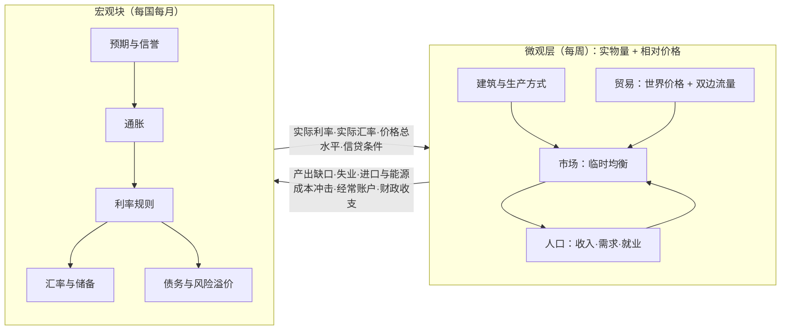

# 经济模型：取舍与设计

> 版本 v0.3。本文回答一个问题：怎样在**直观、好玩、好调**的前提下，尽量多地复现真实的经济学规律。
> 第 5 节的宏观块已经写成代码（`packages/sim/src/macro/`），可以用 `pnpm macro` 运行；第 7 节中标 ✅ 的规律都有对照测试。

---

## 0. 结论先行

**为什么"写微观内核、让宏观自己长出来"很难调？** 根本原因不是参数多，而是**结构**：价格靠试错式的动态调整，容易振荡；正反馈回路没有阻尼；名义价格没有锚，会整体漂移；参数没有经济含义，只能盲调；宏观上最重要的东西（预期、信誉、利率规则）本来就不是简单微观规则的产物。

**我们的取舍，一句话：** 实物和相对价格交给微观模拟，名义变量和经济周期交给宏观方程；规律尽量来自**结构**和**会计恒等式**，而不是来自精细的动态调参。具体是三条：

1. **两层分工。** 微观层（建筑、人口、市场）决定"生产什么、在哪里生产、谁有工作、谁的收入高"，全部以实物量和相对价格计算。宏观块（每国每月一组方程）决定通胀、利率、汇率、债务、信誉。两层只通过少数几个变量耦合。
2. **结构上就稳定。** 价格每回合直接解出，而不是靠试错逼近；所有调整速度用"半衰期"表达；可能发散的响应都有饱和上限；无法保证稳定的更新改为隐式求解。
3. **参数有含义，调参靠工具。** 每个参数都是弹性、份额、半衰期或阈值，带单位和合理范围；每条声称的规律都有自动测试；最后用真实历史数据做自动校准，而不是手工拧旋钮。

**原型已经证明了什么。** 宏观块有 41 个参数（另有需求替身 10 个）、12 个场景，宏观块的 82 条测试全部通过：
- 17 条规律在标定参数下检验：12 条是**对照测试**（两次运行只差一个机制或一项政策），5 条是同一次运行中的模式（例如滞胀：同一次冲击里通胀上升、产出下降；通胀税只稀释本币债务，外币债务反而上升）；另有 2 条检验量级和稳态（费雪效应、相对购买力平价）；
- 1 条把这 17 条规律放到标定值附近重新检验：每个参数在标定值 ±20% 内随机取值，25 组参数下全部成立；
- 58 条**机制测试**，每条锁住一个机制（例如风险溢价有上限、违约后的市场排斥、债务会计精确守恒、利率下限不被记成紧缩立场、重组债务在市场重新开放后逐步到期）；
- 4 条**数值安全测试**：一条重放审查中曾经振荡的参数组合；一条在文档范围内抽样全部参数（均匀抽样、只取端点、两者混合）和全部政策数值（含中途改变政策），每个场景跑满 100 年，要求每个月的结果都有限、有界（债务不超过违约阈值），任何十年窗口和任何三年窗口里都没有高频振荡（平均三个月最多一次反转）。测试用一个固定种子，提交前另用 200 个种子复验（见第 10 节）。
- **变异测试**：把模型、场景运行器和命令行中的机制逐一删掉或改坏，检查测试能否发现（见第 10 节）。

**承诺的边界。** 参数与政策数值的整个文档范围内保证**数值安全**：每个月的结果有限、有界。高频振荡的检查在测试的种子下全部通过，但不是对整个范围的保证：换种子和随机数生成器复验时，少数接近端点的参数组合会出现持续的振荡（第 8、10 节）。经济规律保证在**标定值附近**成立。在范围的极端组合下（例如风险溢价极陡、利率几乎不调整），某些规律可能不再成立：那是另一种经济，不是数值错误。

第 10 节记录了原型中遇到的问题，以及对抗性审查发现的问题。它们**几乎全部是结构问题，改结构就解决了**，没有一个是靠反复调参数解决的。

## 1. 难调的根源

| 根源 | 表现 | 对策 |
|---|---|---|
| 价格靠试错逼近 | 价格振荡、发散，调整速度稍大就崩 | 每回合直接解出出清价格（临时均衡） |
| 正反馈没有阻尼 | 工资—物价螺旋、通缩螺旋、资本外逃无限放大 | 有界响应 + 半衰期式的部分调整 |
| 名义锚缺失 | 物价总水平随机漂移，通胀无从解释 | 相对价格与价格总水平分离，后者由宏观方程决定 |
| 参数没有含义 | 只能盲调，改一个参数牵动全局 | 每个参数都有单位、范围、经济含义和文献依据 |
| 钱凭空产生或消失 | 长期运行后数值漂移 | 会计恒等式由代码保证，并作为不变量测试（例外见第 8 节） |
| 反馈周期太长 | 要跑几十年才知道哪里错了 | 每个模块可以单独测试；宏观沙盒秒级出结果 |
| 微观规则推不出宏观规律 | 没有预期、信誉、政策规则 | 这些直接写成宏观方程 |

## 2. 设计原则

1. **两层分工**：微观算实物与相对价格，宏观算名义变量与周期。
2. **临时均衡**：每回合在给定供给下直接解出价格；数量调整慢，价格调整快。
3. **半衰期**：所有调整速度都写成"多少个月缩小一半差距"，而不是一个抽象系数。
4. **有锚**：每个变量都有长期锚（正常成本、中性利率、潜在产出、均衡实际汇率），短期是对锚的偏离。
5. **有界响应**：所有可能发散的量都有上下限：资本流动、产出缺口、经常账户、风险溢价、实际汇率偏离（钉住时到达上限就重新定价）、通胀、实际利率对需求的影响、货币需求的萎缩；债务超过阈值就违约减记，随后一段时间被市场排斥，期间债务不会回升到重组后的水平以上。上限本身也是有含义的参数。
6. **隐式求解**：资本流动和贸易对汇率的反馈放在同一个单调方程里，每步用二分法解出。参数在文档范围内任意取值、跑满 100 年都不发散、不振荡，这由属性测试验证。
7. **显式冲击**：经济周期的"起因"是显式的随机冲击（就像真正的宏观模型那样），"传导"才交给系统。
8. **会计恒等式由代码保证**：资金、人口、国际收支（固定汇率部分）、债务动态。
9. **每条规律一个测试，每个机制一条锁**：能做对照的规律，两次运行只差一个机制；每个机制都有一条去掉它就会失败的测试（用变异测试检查）；最后用真实数据自动校准。

## 3. 两层结构



耦合变量只有这几个，所以两层可以各自单独测试：

- **微观 → 宏观**：产出缺口（实际产出相对正常开工产出）、失业率、进口与能源相对价格的变化（成本冲击）、经常账户、财政收支。
- **宏观 → 微观**：实际利率（影响储蓄与投资）、实际汇率（影响进出口竞争力）、价格总水平（只用于把实物价值换算成名义数字给玩家看）、信贷条件。

## 4. 微观层（设计，下一阶段实现）

### 4.1 单位与价格归一

- 所有商品有一个**基准价格**（数据中给定），实物量 × 基准价格 = 不变价产出。实际 GDP、产业结构、增长率都以此计算。
- 市场中形成的是**相对价格**。每回合把一国的价格指数归一到 1：微观层只决定"什么东西相对更贵"，价格**总水平**只由宏观块决定。这样通胀不会被重复计算，也不会在微观层随机漂移。
- 一个重要的推论：当总需求不足时，归一后的相对价格不会整体下跌，而是表现为**卖不出去 → 开工率下降 → 产出缺口为负**。这正是凯恩斯式的短期（价格总水平有粘性，数量调整），长期则由相对价格和投资调整（古典式）。

### 4.2 每回合临时均衡

- 回合内**供给是给定的**（本回合产出 + 库存），需求是常弹性函数。出清价格直接解出：

```
p* = p × (需求 / 供给)^(1 / 需求弹性)，再限制在 [基准价 × 0.2, 基准价 × 5] 之内
```

- 价格管制的商品价格固定，缺口通过**配给**（按优先级分配，计划经济里"先保工业还是先保民生"是玩家的选择）体现，部分溢出为黑市。
- 数量调整慢：开工率以约 2 个月的半衰期向盈利目标调整，产能扩张以年计。价格快、数量慢，这本身就保证了稳定。

### 4.3 生产与开工率

- 建筑按生产方式的配方（固定比例）消耗投入、雇用劳动、产出商品。
- 开工率 = min（劳动力满足率，投入满足率）× 盈利调节；长期亏损则降级或关停（国企在软预算约束下可以不关停，由财政兜底）。
- 生产率 = 生产方式 × 技术距离前沿的程度 × 基础设施 × 管理质量 × 集聚效应 × 气候。

### 4.4 需求

- 人口的消费用**线性支出系统**（Stone–Geary）：先满足每个需求类别的"最低量"，剩余收入按边际预算份额分配。参数是"每人最低需要多少"和"多出的钱有多少花在这一类"，都可以用住户调查数据校准；**恩格尔定律**自然出现。
- 类别内部按相对价格替代（常替代弹性）。例如"交通"类别里：自行车、摩托车、燃油车、电动车、公共交通。新增商品只需把它加入某个类别。
- 储蓄率由年龄结构（生命周期）、实际利率、收入和社会保障程度决定。

### 4.5 劳动力与工资

- 劳动力池按"地区 × 受教育层级"划分，高学历可以向下就业。
- 工资有粘性：以约半年的半衰期向"岗位愿意支付的工资"调整，下限是非正规部门收入 × 溢价，以及最低工资。
- 找不到正规工作的人回落到非正规部门，收入由当地土地与人口压力决定——**刘易斯拐点**由此涌现：剩余劳动力被吸收完之前，工资几乎不涨；之后快速上涨。
- 城乡迁移按哈里斯—托达罗模型：期望城市收入 = 城市工资 ×（1 − 城市失业率）。

### 4.6 投资

- 私人投资：预期回报率高于"实际利率 + 风险溢价"的项目获得资金，在候选项目间按回报率做 softmax 分配（一个"资本逐利强度"参数）。
- 国有投资：由玩家或 AI 计划直接分配。
- 建设本身是一个部门，消耗建材、机械和劳动，产能有限——基建热潮会推高建材价格。

### 4.7 贸易

1. **世界价格与净贸易**：每种商品一个世界价格（集团对立时每个贸易圈一个）。国内价格高于"世界价格 ×（1 + 贸易成本）"时进口、低于"世界价格 ×（1 − 贸易成本）"时出口，贸易量以几个月的半衰期向目标调整（**J 曲线**由此产生：贬值后价格立刻变化，数量慢慢跟上）。
2. **双边流量**：用引力模型把出口分配给进口国，权重由距离、关系、协定、制裁决定。双边流量用于计算依赖与筹码。

### 4.8 住房与本地服务

住房和本地服务按地区结算，其余商品按国家市场结算。城市房价由此出现，并影响生育意愿与满意度。

## 5. 宏观块（已实现原型）

每国每月一组方程。利率、通胀、贬值都是连续复利的年化率，所以价格水平和汇率按对数存储，永远不会溢出；命令行显示时换算成普通年率。代码：`packages/sim/src/macro/model.ts`；参数与说明：`pnpm macro --params`。

**汇率制度与资本账户不是枚举，而是数值**：汇率灵活度（0 = 钉住，0.5 = 有管理浮动，1 = 自由浮动）与资本流动性。爬行钉住、货币局这类法律选项只是这些数值的不同组合，加选项只改数据。央行的法律地位同样只决定两件事：是否按规则定利率，以及能达到的基础信誉。

| 步骤 | 方程（文字版） | 对应规律 |
|---|---|---|
| 风险溢价 | （政治风险 + 违约的声誉溢价）+ 斜率 × max(0, 债务 − 安全债务)² + 斜率 × 储备短缺程度，再经饱和上限；声誉溢价在违约时为满额，之后按半衰期消退，市场重新开放后仍然存在 | 债务风险的凸性、储备与投机攻击、违约的声誉代价 |
| 债务利率 | 都按当月的利率计算。本币市场债务每月有一部分到期，按（当月政策利率 + 风险溢价 + 期限溢价）重新发行，平均利率按存量加权。新债的期限随通胀缩短（高通胀下没人肯按固定利率长借，期限按关注度缩短）；存量的期限只随再融资逐步变化，所以通胀起落时不会追溯改变已发行债务的期限。外币债务按锚货币利率 + 风险溢价计息；政府的净资产放在海外，按锚货币利率计息。违约重组后的本币债务是指数化的：通胀加在本金上，现金只付锚货币实际利率。被市场排斥期间不借新还旧，外币债务不付风险溢价；市场重新开放后，指数化债务按正常时期的半衰期到期，到期部分按当月市场利率换成新债，所以不会一次性重新定价 | 借新还旧、期限结构、重组、高通胀下期限缩短 |
| 财政 | 现金赤字 = 当月现金利息（含外币利息，按当月 GDP 计）− 基本盈余。央行计划的印钞 = 货币化比例 × max（0，预算中的基本赤字 + 近几个月的平均利息），平均利息按月初的债务和当月的利率计，不看当月的通胀和汇率；预算的赤字当月就印，计划不会跟着现金流开开关关。人们按计划形成预期；实际印出的不超过货币化比例乘当月的现金赤字（排斥期内为全部基本赤字），所以债务被通胀消灭之后，印钞不会创造净资产。印出的钱先支付到期的外币利息，其余偿还本币债务；没有印钞、需要借入的那部分才按外币借款比例借外债，所以全额印钞的政府既不会把本币债务换成外币债务，也不借外债。被市场排斥期间利息计入本金、不付现金，基本赤字只能全部印钞 | 财政主导、违约后的货币化 |
| 信誉 | 目标信誉 = 基础信誉 − 偏离惩罚 × 超出容忍度的"记忆中通胀"偏离 − 印钞惩罚 × 印钞；以半衰期向目标靠近。偏离取两者中较大的一个：记忆中的通胀离通胀目标多远，离相信央行的人所预期的货币锚（下一行）多远。不印钞时两者相同；大量印钞的央行即使通胀恰好落在目标附近也赢不来信誉，否则信誉一上升，预期就被拉向印钞的锚，通胀又离开目标，形成周期 | 信誉靠过往记录挣来 |
| 货币锚 | 通胀目标 + 系数 × 民众感知的印钞额 ÷ 货币需求。民众察觉印钞的速度与察觉通胀相同：通胀越高越快，恶性通胀中几周就跟上；货币需求 = max（下限，e^(−卡甘半弹性 × 记忆中通胀)），所以只有大量印钞才能维持恶性通胀 | 货币数量论、卡甘货币需求、铸币税上限、恶性通胀的终结 |
| 预期 | 信誉 × 货币锚 +（1 − 信誉）× 记忆中通胀 | 预期锚定 |
| 通胀 | 预期 + 斜率 × 产出缺口 + 成本冲击 + 汇率传导，限制在上下限之间 | 预期增强型菲利普斯曲线、滞胀 |
| 汇率传导 | 实际贬值先进入"待传导"存量，按半衰期逐月传到物价 | 汇率传导的滞后 |
| 记忆 | 记忆中通胀以"基础半衰期 ÷（1 + 关注度 × 记忆中通胀）"向实际通胀靠近 | 通胀越高，人们越关注物价 |
| 利率 | 独立央行：利率中跟随预期通胀的部分立即调整（费雪效应），其余的"政策立场"以半衰期向目标靠近，目标是中性实际利率 + 有界的调整（系数 × 预期通胀偏离 + 系数 × 缺口）；汇率越固定、资本越自由，立场越要跟随锚货币利率 + 风险溢价。立场在利率下限之前计算，所以下限约束过的月份不会被记成紧缩立场。政府控制时由玩家设定 | 泰勒原则、费雪效应、不可能三角 |
| 资本流动 | 上限 × tanh（流动性 ×（利差 − 预期贬值 + 均值回归项）÷ 上限）。预期贬值 =（灵活度 + 固定部分 × 偏离程度）× 预期通胀差：固定汇率在实际上偏离得越远，投资者越预期它会重新定价，到偏离上限时预期它完全跟随通胀差。被市场排斥期间外国资本不进入，只能流出 | 利率平价、突然停止的规模、第一代货币危机 |
| 汇率 | 浮动部分：在一个单调方程里同时考虑经常账户和资本流动，二分法解出新的实际汇率，并限制在偏离上限内；固定部分不随通胀调整，实际汇率随通胀差漂移，漂到偏离上限时重新定价；储备承担压力，储备不够的部分记为"特殊融资"（拖欠、紧急贷款），资本流动仍是市场的真实流动；储备低于阈值则钉住崩溃并一次性贬值 | 汇率超调、货币危机、国际收支恒等式 |
| 债务率 | 本币债务（市场债务与指数化债务各自复利）与外币债务分开、按精确复利计算：本币债务被通胀稀释，外币债务随贬值重估；一种存量为负时先偿还另一种，净资产放在海外；超过阈值则违约，减记到"阈值 ×（1 − 减记比例）"，并在一段时间内被市场排斥。排斥期内不会再次违约，债务也不会回升到重组后的水平以上：重组仍在结算，超出的部分一并减记 | r − g 债务动力学、通胀税、货币错配、违约与重组 |

在完整游戏中，产出缺口、成本冲击、经常账户来自微观层；原型里由一个"需求替身"提供（`demand-proxy.ts`）：一条 IS 曲线（私人借贷成本 = 实际利率 + 主权风险溢价，影响有饱和上限；通胀偏离目标有产出代价，偏离小时近似平方、偏离大时近似线性；缺口有饱和上限），加一条有饱和上限的经常账户方程，并告诉汇率求解器经常账户对汇率的局部敏感度。这个替身之后不会删除：顾问和 AI 会用它做快速预测（"如果加息 2 个百分点，预计……"）。

**12 个场景**（`pnpm macro <场景>`）：稳态、财政扩张、石油冲击（预期稳定 / 预期失锚）、反通胀、财政主导、恶性通胀、钉住汇率（资本开放 / 资本管制）、有管理浮动 + 部分开放、钉住汇率遇上衰退、债务螺旋。每个场景的说明文字都是照着实际输出写的。

## 6. 金融周期（设计，下一阶段实现）

- 状态：信贷 / GDP 缺口、资产价格指数（股市与房地产）、杠杆率。
- 资产价格有外推型预期（涨了还会涨），但有界；信贷扩张推高资产价格，资产价格上涨又放松抵押约束——这个正反馈有明确的增益参数，并且小于 1。
- 危机概率 = f（信贷缺口、资产高估、杠杆率）；危机发生时：信心冲击、投资骤降、银行亏损转化为财政成本。
- 宏观审慎、分业经营等法律降低增益与危机概率，代价是平时的增长更慢。

## 7. 经济规律清单

类型：**结构**＝从模型结构中自然产生；**方程**＝写成显式方程；**会计**＝由会计恒等式保证。
状态：✅ 已实现并有测试；◐ 已实现、待补测试；○ 已设计、待实现。

| # | 规律 | 怎么得到 | 类型 | 状态 |
|---|---|---|---|---|
| 1 | 预期增强型菲利普斯曲线 | 通胀 = 预期 + 斜率 × 缺口 | 方程 | ✅ |
| 2 | 泰勒原则 | 信誉相同时，固定名义利率让通胀持续偏高，按规则加息则回到目标 | 方程 | ✅ |
| 3 | 滞胀 | 成本冲击同时推高通胀、压低产出 | 方程 | ✅ |
| 4 | 预期锚定与央行信誉 | 同样的冲击，信誉低的国家通胀更持久 | 方程 | ✅ |
| 5 | 反通胀的代价（牺牲率） | 信誉低时，反通胀损失的产出更多 | 结构 | ✅ |
| 6 | 信誉靠过往记录挣来 | 信誉按记忆中的通胀评估，一个月的好数据不够；大量印钞的央行，通胀碰巧落在目标附近也不算好记录 | 方程 | ✅ |
| 7 | 费雪效应 | 稳态下名义利率 = 实际利率 + 通胀 | 结构 | ✅ |
| 8 | 相对购买力平价 | 浮动汇率按通胀差漂移 | 方程 | ✅ |
| 9 | 货币数量论（长期） | 印钞越多，通胀平台越高 | 方程 | ✅ |
| 10 | 铸币税上限与恶性通胀 | 卡甘货币需求（有下限）：超过上限即自我加速，零星印钞维持不了恶性通胀 | 方程 | ✅ |
| 10b | 恶性通胀的终结 | 停止印钞后，民众很快察觉，货币锚回到目标，通胀在几个月内见顶、之后逐月回落，两年后只有继续印钞时的一小部分；回落的速度取决于信誉，见第 8 节（萨金特《四次大通胀的结束》）。决定性的检验是见顶时间和逐月回落：继续印钞的对照组卡在通胀上限，只起保底作用 | 对照 | ✅ |
| 11 | 通胀税只稀释本币债务 | 本币债务被通胀稀释，外币债务不会 | 会计 | ✅ |
| 12 | 不可能三角 | 钉住时资本越自由，储备流失越快；汇率越灵活，压力越多地落在汇率上；保卫钉住就不能为衰退降息 | 结构 | ✅ |
| 13 | 国际收支恒等式 | 固定汇率下，储备变化 = 经常账户 + 资本流动 + 特殊融资 | 会计 | ✅ |
| 14 | 货币错配（"原罪"） | 贬值使外币债务立刻膨胀 | 会计 | ✅ |
| 15 | 双赤字 | 财政扩张 → 过热与进口增加 → 经常账户赤字（汇率不动时也成立） | 结构 | ✅ |
| 16 | 储备与投机攻击 | 储备下降推高风险溢价 | 方程 | ✅ |
| 17 | 突然停止的规模 | 资本流动有饱和上限 | 方程 | ✅ |
| 18 | 债务螺旋与违约 | 凸性风险溢价与债务相互推高，最终违约减记；之后一段时间被市场排斥（只能印钞、外国资本不进入），市场重新开放后仍要付逐渐消退的声誉溢价 | 会计 + 方程 | ✅ |
| 19 | 主权风险外溢 | 私人借贷也要付主权风险溢价：两个只差政治风险的经济，违约之前风险高的那个衰退更深 | 对照 | ✅ |
| 20 | 汇率传导的滞后 | 贬值分几个月传到物价 | 方程 | ✅ |
| 21 | 高通胀的产出代价 | 恶性通胀最终带来深度衰退 | 方程 | ✅ |
| 22 | 美元化 | 实际汇率偏离达到上限后不再继续扩大 | 方程 | ✅ |
| 23 | 汇率超调 | 市场预期实际汇率回归均衡 | 方程 | ◐ |
| 24 | 第一代货币危机 | 钉住 + 通胀差 → 实际高估 → 投资者预期重新定价、资本流出 → 储备流失、钉住崩溃 | 结构 | ✅ |
| 25 | 低利率货币的资本外流与贸易顺差 | 利差决定资本流向，经常账户为其融资 | 结构 | ◐ |
| 26 | 恩格尔定律 | 线性支出系统 | 结构 | ○ |
| 27 | 结构转型（农业 → 工业 → 服务业） | 收入弹性差异 + 生产率增速差异 | 结构 | ○ |
| 28 | 鲍莫尔成本病 | 服务生产率增长慢，而工资跨行业趋同 | 结构 | ○ |
| 29 | 巴拉萨—萨缪尔森效应（富国物价更高） | 不可贸易服务的价格随工资上升 | 结构 | ○ |
| 30 | 比较优势与贸易利得 | 相对成本决定贸易方向 | 结构 | ○ |
| 31 | 贸易引力模型 | 双边流量分配 | 方程 | ○ |
| 32 | J 曲线 | 价格立即变化，贸易量滞后调整 | 结构 | ○ |
| 33 | 刘易斯拐点 | 非正规部门作为劳动力蓄水池 | 结构 | ○ |
| 34 | 哈里斯—托达罗迁移 | 期望收入决定迁移 | 方程 | ○ |
| 35 | 库兹涅茨曲线 | 二元经济转移过程中不平等先升后降 | 结构 | ○ |
| 36 | 索洛收敛与追赶增长 | 资本边际收益递减 + 技术向前沿扩散 | 结构 | ○ |
| 37 | 中等收入陷阱 | 越过拐点后，增长取决于人力资本与创新 | 结构 | ○ |
| 38 | 普雷维什—辛格假说 | 初级产品收入弹性低，贸易条件恶化 | 结构 | ○ |
| 39 | 荷兰病 | 资源出口 → 实际升值 → 制造业萎缩 | 结构 | ○ |
| 40 | 资源诅咒（政治） | 租金减少对税收的依赖，削弱问责 | 方程 | ○ |
| 41 | 价格管制导致短缺与黑市 | 固定价格下的配给 | 方程 | ○ |
| 42 | 软预算约束 | 国企亏损由财政兜底 | 方程 | ○ |
| 43 | 计划的信息问题 | 计划效率随经济复杂度下降 | 方程 | ○ |
| 44 | 学习曲线（莱特定律） | 新技术成本随累计产量下降 | 方程 | ○ |
| 45 | 资源枯竭与勘探 | 储量、发现与开采成本 | 方程 | ○ |
| 46 | 拉弗曲线 | 税率越高，逃税与非正规化越多 | 方程 + 结构 | ○ |
| 47 | 奥肯定律 | 开工率与就业同向变化 | 结构 | ○ |
| 48 | 生命周期储蓄与人口红利 | 储蓄率随年龄结构变化 | 方程 | ○ |
| 49 | 人口转型 | 死亡率先降、生育率后降 | 方程 | ○ |
| 50 | 财政乘数与节俭悖论 | 需求不足时数量调整 | 结构 | ○ |
| 51 | 金融周期与"明斯基时刻" | 信贷—资产价格的有界正反馈 | 方程 | ○ |
| 52 | 外部性与庇古税 | 污染与碳排放的社会成本 | 方程 | ○ |
| 53 | 公地悲剧（气候） | 全球碳存量，单国减排收益外溢 | 方程 | ○ |
| 54 | 特里芬难题 | 储备货币国必须向世界提供流动性 | 结构 | ○ |

## 8. 我们放弃了什么

明确写下来，免得以后反复纠结：

- **不做单个企业、单个家庭的最优化**；人口与建筑都是群体。
- **通胀不从微观价格中涌现**，由宏观方程给出。换来的是稳定、可解释、可调。
- **经济周期的起因是显式冲击**，传导才由系统完成（这和真实的宏观模型做法一致）。
- **不做完整的一般均衡求解**：每回合临时均衡 + 慢变量调整。
- **金融体系高度简化**：没有单个银行，只有部门层面的信贷与资产价格。
- **预期不是完全理性的**：信誉 + 适应性记忆的组合，足够产生上面的规律，也让玩家看得懂。
- **违约与货币危机目前自动处理**：违约直接减记并触发一段市场排斥，钉住崩溃直接转为浮动。在游戏里它们会变成有选择、有代价的事件（例如重组谈判、国际救助）。
- **浮动汇率下的国际收支是逐月出清，而不是恒等式**：汇率按不平衡的大小移动，不会一步到位，所以某个月的经常账户 + 资本流动不一定为零，差额视为私人部门的短期融资，没有单独记账。微观层接入后经常账户来自真实贸易，届时再决定是否显式记账。
- **钉住汇率下储备可以无限积累**：顺差国冲销外汇流入的成本还没有建模。
- **政府的对外收付不经过国际收支**：借入外债和支付外币利息都不进入储备和汇率方程。原来外币利息滚进外债，等于向外国借钱付息，本身就是自我融资；第八轮起印出的本币先支付外币利息，现实中这笔外汇要从储备或外汇市场买入，模型里没有这一步。量级（第九轮审查）：资本管制的钉住汇率、货币化比例 0.3、预算基本平衡，钉住崩溃前累计约 2 个月进口额的外币利息由印钞支付；钉住汇率、资本管制、赤字 1%、全额印钞，20 年累计约 10 个月进口额（约 GDP 的 22%）。要计入储备和汇率方程，得先确认不会让汇率与印钞之间的回路重新变强（第五、七轮审查都遇到过这类回路），所以暂时只写明这一简化。
- **政府净资产没有上限**：海外净资产按"锚货币实际利率 − 潜在增长"复利，长期盈余还会继续积累，并随实际汇率重估。结果有限，但外部输入取极端组合时（例如锚货币利率 30%、增长 −5%），百年后的数字可以极大。
- **需求替身没有净出口对需求的影响**：实际汇率只影响经常账户，不影响产出缺口；所以钉住汇率的实际偏离靠重新定价收住，而不是靠贸易推动的复苏。微观层接入后，净出口直接来自贸易。
- **通胀的产出代价按偏离目标计算**：公开的通胀目标已经写进合同与价格，主要代价来自偏离；目标本身很高时的代价没有建模（所以法律把目标定在 20%，就不会因 20% 的通胀损失产出）。
- **个别端点组合下稳态不是吸引子**：例如利率对需求完全没有影响时，舍入误差会放大成一次有界的偏离，之后再回到稳态。属性测试的"稳态保持不动"只对均匀抽样的参数检查 20 年。
- **极端参数组合下仍可能出现几个月的周期**：第五轮审查找到的三个高增益回路已经从结构上去掉（其中信誉回路当时只被信誉半衰期的下限减弱，第八轮复验时才去掉，见第 10 节）；剩下的是经济本身的不稳定：浮动汇率对资金流动反应极大、资本流动性很高、汇率传导很快（传导系数最大、半衰期最短），多数还有过度反应的利率规则（工具不稳定）；这些例子的预期记忆半衰期都在下限；印钞系数多数在下限（7 个中 5 个），另外两个例子振荡时印钞和信誉都不动，所以与印钞无关。振荡一旦出现，往往持续几十年；债务路径稍有不同，同一组参数可能振荡，也可能不振荡。第九轮复验用两种随机数生成器、300 个种子、324,000 次百年运行：全部有限、有界；7 个种子里有运行超过振荡阈值（十年窗口最多 49 次反转，三年窗口最多 20 次），都是接近端点的组合（第九轮审查在修正前的代码上另用三种生成器、648,000 次运行找到 9 个，同属这一类）。所以属性测试的振荡阈值只对测试固定的种子成立，不是对整个范围的保证。
- **财政主导下，为名义利息印钞容易滑向恶性通胀**：央行为利息（含通胀补偿）印钞，通胀越高利息越多、印得越多，回路会自我加速（"不愉快的货币主义算术"）；高通胀下新债短借、利率更快跟上，让这条路更陡。财政主导场景把本币债务提高到 GDP 的 50%：第 4 年同比通胀约 70%，第 5 年进入恶性通胀；如果新债期限不随通胀缩短，第 5 年约 125%，第 6 年才进入。15 年内出现恶性通胀的起始债务门槛约为 GDP 的 40%（37.5% 不会），期限不缩短时约 47.5%。高通胀国家的债务期限确实很短，但这些数字没有用数据校准。
- **人们按计划的印钞形成预期，计划只会高于实际**：计划里有近几个月的平均利息；债务被通胀消灭、利率骤降或政策突变之后，这部分利息已经不存在，人们仍然"看到"它，所以感知的印钞偏高，通胀也偏高。财政主导、本币债务 0.5 倍 GDP：第 60 个月计划 6.7% GDP，实际 1.9%；债务 1.5 倍 GDP：20 年累计计划是实际的 1.5 倍，单月最多 18.7 倍。表格里"计划印钞"和"实际印钞"两列分开显示。让计划随存量消失而缩小的朴素做法会让汇率与印钞的回路重新振荡，所以暂时保留这个偏差。
- **恶性通胀的终结是渐进的**：停止印钞后，民众几周内就察觉，通胀在几个月内见顶回落；但信誉只随通胀记录变化，制度更迭本身不恢复信誉，所以回落是逐月的。恶性通胀场景中停止印钞、平衡预算：一年后约 300%，两年后约 150%；同时改为独立央行：一年后约 260%，两年后约 60%。萨金特描述的"几周内结束"来自制度更迭一下子恢复了信誉（独立央行、财政改革、新货币），要等事件层的货币改革来建模。
- **随机参数下，"稳态"场景也常常违约**：财政政策固定时，只要利率高于增长率（r > g），债务必然发散。这是正确的经济学，不是数值错误；所以属性测试只检查数值安全，规律测试只在标定值附近进行。
- **跨引擎的浮点一致性**：`Math.exp`、`Math.tanh` 在不同 JavaScript 引擎上可能有最后一位的差异。目前 Node 与 Electron 都是 V8，结果一致；如果将来要在其他引擎上回放，再自带这些函数的实现。

## 9. 调参与校准工具链

1. **参数表**：每个参数有含义、单位、范围（`pnpm macro --params`）；超出范围直接报错。
2. **宏观沙盒**：`pnpm macro <场景> --set 参数=值`，不改代码就能换参数，秒级看到逐年的表格（`--monthly` 看逐月）。
3. **对照测试与属性测试**：每条规律一个对照测试，调参后跑 `pnpm test`，立刻知道哪条规律被破坏了；属性测试保证整个参数范围都是数值安全的，所以调参时不用担心把模型调崩。
4. **历史校准**（真实世界开局之后）：把真实数据的统计特征当作目标，例如各国通胀的均值与波动、利率与通胀的关系、债务路径、人口与城市化轨迹、产业结构变化；用随机搜索或 CMA-ES 在 CPU 多核上并行跑无头模拟，自动寻找参数。
5. **敏感度报告**：自动列出"哪个参数对哪个结果影响最大"，调参时只需关注少数几个。

## 10. 原型中遇到的问题

这一节值得单独记下，因为它说明了**大多数"调参困难"其实是结构问题**：

| # | 现象 | 根源 | 修正（结构，不是调参） |
|---|---|---|---|
| 1 | 财政扩张时通胀反而下降；预期失锚时通胀冲到 5000%、汇率变成无穷大 | 浮动汇率缺少"会回归均衡"的预期，资本流动和贬值无限放大 | 加入实际汇率均值回归预期（汇率超调模型） |
| 2 | 参数稍大时汇率来回振荡 | 显式更新在增益大于 1 时不稳定 | 改为隐式求解（二分法）；整个参数范围内的稳定性由属性测试验证 |
| 3 | 恶性通胀时资本外逃达到 GDP 的 1600%，经济"过热" 45% | 线性响应在极端情况下失效 | 资本流动与产出缺口加饱和上限 |
| 4 | 温和印钞时通胀一直爬升、不收敛 | 汇率传导重复计算了"按通胀差贬值"的部分 | 只有**实际**贬值（进口品相对变贵）才传导到通胀 |
| 5 | 从 13% 反通胀到 3%，几乎不付出产出代价 | 信誉按当月通胀评估，一降就回升；利率规则跟着当月通胀走 | 信誉按"记忆中的通胀"评估；利率规则直接设定实际利率 |

问题 4 是"规律测试"发现的：测试要求"财政主导下通胀停在一个平台上"，而实际结果一直在爬升。所以测试不只是防止回退，也是发现模型错误的工具。

### 对抗性审查发现的问题

原型完成后，独立的审查子代理用随机参数扫描、变异测试和延长运行去证伪，找到了下面这些问题，全部已修正：

| 发现 | 根源 | 修正 |
|---|---|---|
| 在参数文档范围内随机抽样，25.8% 的运行出现 NaN 或无穷大；默认参数跑到 17—19 年也会出事 | 汇率与贸易之间是显式的滞后反馈；若干量没有上限 | 贸易反馈并入汇率的隐式方程；所有可能发散的量加上下限；收紧不现实的参数范围；加入"随机参数 × 百年"的属性测试 |
| 债务风险溢价没有上限，债务在有限时间内爆炸 | 溢价与债务平方成正比，利息与债务立方成正比 | 溢价饱和；超过阈值违约并减记 |
| 价格水平会溢出 | 对数率与水平值混用 | 价格水平、汇率按对数存储，显示时换算 |
| 某些参数下通胀每月来回跳（周期为 2 的振荡） | 利率规则对当月通胀反应，而当月通胀包含上月汇率变动一次性的传导 | 利率规则对预期通胀反应；汇率传导按半衰期分摊 |
| 外币债务也被通胀"稀释" | 外币债务占比被当作常数 | 本币、外币债务分开记账，按精确复利计算 |
| 两条规律测试测的不是它声称的机制 | 测试同时改变了两个因素 | 改为只差一个机制的对照测试，并用变异测试验证 |
| 储备在 0 处截断，破坏国际收支恒等式 | 储备不足时外流仍然记账 | 储备不足时实际外流被截断；增加恒等式测试 |
| 静态分析器遇到 JSDoc 会崩溃，也有漏报和误报 | 节点定位与读写判定过于简单 | 修正定位；`++`、`+=` 视为写入；只为更新自身而读取不算读取；检查普通对象常量；转发规则覆盖更多写法，并跳过默认参数和实现接口的方法 |
| 一批代码路径从未被任何场景用到 | 先写了机制，没写用到它的场景 | 新增"有管理浮动 + 部分开放""钉住汇率遇上衰退"两个场景及测试 |
| 确定性规则可以被绕过 | 只禁止了少数写法 | 禁用 Date、performance、crypto、process、globalThis 等全局量；内容 ID 规则覆盖模板字符串 |
| 汇率制度、资本账户写死成枚举，违反"加法律只改数据" | 类型设计 | 改为数值参数（汇率灵活度、资本流动性） |

这一轮再次说明：难调的根源几乎都是结构，而不是参数取值。

**第二轮审查**（Opus，max effort）专门找属性测试抽不到的参数组合，以及测试没有锁住的机制：

| 发现 | 根源 | 修正 |
|---|---|---|
| 参数取在范围端点附近时，通胀每月来回跳 | 均匀抽样几乎抽不到端点组合；利率、传导半衰期允许短到半个月，规则系数允许很大 | 收紧范围（利率与传导半衰期 ≥ 1 个月、缺口系数 ≤ 1.5 等）；实际利率对需求的影响加饱和上限；通胀的产出代价同时改为 log-cosh（偏离大时近似线性；事后的变异测试表明它对稳定性不是必需的，见下文）；属性测试增加"只取端点"和"混合"两种抽样 |
| 违约之后很快再次违约，反复"抖动" | 减记之后照样借新债，债务很快又超过阈值 | 违约后一段时间被市场排斥（不能借新债），并付声誉溢价；属性测试要求两次违约的间隔不短于排斥期 |
| 违约之后出现恶性通胀 | 排斥期间连利息也印钞 | 已违约债务的利息计入拖欠，只印基本赤字 |
| 违约之后资本反而流入 | 减记让债务率下降，风险溢价跟着下降 | 声誉溢价：刚违约的国家要付更高的溢价，随排斥期结束而消退 |
| 储备耗尽时出现"虚假的资本流入"，超过资本流动上限 | 储备不够的部分被记成资本流动 | 单独记为"特殊融资缺口"；资本流动保持有界 |
| 外币债务在 0 处截断时，债务凭空消失 | 截断的部分没有记到别处 | 超额还款精确地记到本币债务上；用 500 组随机状态检验债务会计精确守恒 |
| 参数范围互相矛盾（例如安全债务可以高于违约阈值） | 各参数单独定范围 | 相关参数的范围改为互不重叠 |
| 政策数值没有校验 | 只校验了参数 | 政策数值同样有范围，运行前和每次政策变化后都校验 |
| 命令行 `--set` 能设置原型链上的名字 | 用 `in` 判断参数是否存在 | 改用 `Object.hasOwn` |
| 场景里有两个从来不起作用的字段 | 初始缺口、基准经常账户可以由模型推导 | 删除，改为由模型推导 |
| 文档声称规律在整个参数范围内成立，但随机参数下货币数量论只在 7% 的运行中成立 | 承诺范围写错了 | 明确承诺边界：整个范围保证数值安全，规律在标定值 ±20% 内成立，并对此测试 |
| 46 个变异中有 8 个存活（风险溢价上限、规则调整上限、规则对当月通胀反应、外债付风险溢价、印钞的信誉代价、外币借款比例、浮动汇率不动用储备、储备耗尽时的处理） | 规律测试太宏观，锁不住单个机制 | 每个机制补一条机制测试 |
| 确定性规则仍可绕过（导入 Node 内置模块、把 Math 赋给变量、Reflect） | 只禁止了全局名字 | 禁止导入 Node 内置模块和动态 `import()`；禁止给 Math 起别名、解构或用计算属性访问；禁用 Reflect、eval、Function、定时器、WeakRef 等 |
| 静态分析：绑定 `this` 的箭头函数被误报，`await`、`void` 包着的转发漏报；类只要实现了接口，所有方法都被豁免 | 规则过粗 | 绑定 `this` 的箭头函数豁免；去掉 `await`、`void` 再判断；只豁免基类或接口要求的成员 |

修正之后重新做变异测试：33 个变异中 32 个被测试抓住。唯一存活的是"把通胀产出代价的 log-cosh 换回平方"：在现有范围内两者的稳定性没有差别（各做 4320 次百年运行，都没有振荡），所以 log-cosh 不是稳定性所必需的；保留它是因为它更好解释——偏离越大，每多一个百分点的代价不会无限增加。这不是一条声称的规律，所以没有为它写测试。

**第三轮审查**（Opus，max effort）专门证伪第二轮的修正，找到了修正本身的漏洞：

| 发现 | 根源 | 修正 |
|---|---|---|
| 排斥期内债务和赤字没有上限：端点参数下债务达到 GDP 的数百万倍，而属性测试恰好豁免了排斥期 | 排斥期内拖欠的利息仍按市场利率（含声誉溢价）复利，这段时间又不会违约；名义利率被平滑，通胀骤降后实际利率高达几千个百分点 | 排斥期内不借新还旧：重组后的本币债务与通胀挂钩、按锚货币实际利率计息，外币债务不付风险溢价；排斥期内债务不会回升到重组后的水平以上（超出的部分一并减记）；利率中跟随预期通胀的部分立即调整，只平滑政策立场；属性测试检查每个月的债务，不再豁免 |
| 违约后资本仍然大量回流、本币大幅升值 | 减记降低了债务溢价；央行为对付印钞把实际利率加到 8% 以上；投资者预期汇率回归 | 排斥期内外国资本不进入，只能流出；测试覆盖整个排斥期 |
| 排斥结束当月再次违约，属性测试在构造上发现不了 | 同第一条：排斥期内债务回升 | 同第一条；规律测试要求下一次违约至少在市场重新开放一年之后 |
| 声誉溢价在排斥结束时恰好归零，与文档"排斥结束后还要付"相反 | 声誉溢价按剩余排斥月数计算 | 声誉溢价有自己的半衰期，市场重新开放后仍然存在 |
| 45 个新变异中有一批存活（减记幅度、声誉消退、净资产抵消、特殊融资的缩放、政策变化校验、利率下限、偏离容忍度、钉住时的预期、只有硬钉住才崩溃、经常账户敏感度、冲击与政策的生效月份）；命令行没有任何测试 | 规律测试太宏观 | 每个机制补一条机制测试；命令行拆出参数解析与表格两个模块，并加测试 |
| 政策数值从未被属性测试抽样；极端政策下净资产达到 GDP 的 10⁴⁶ 倍，还出现周期 3 的循环 | 净资产按本币利率复利，通缩陷阱里实际利率极高；钉住汇率的实际偏离没有上限；赤字在零附近时印钞一开一关，又被没有下限的货币需求放大成恶性通胀 | 属性测试同时抽样政策；净资产放在海外、按锚货币利率计息；钉住汇率漂到偏离上限时重新定价；货币需求有下限；民众按近几个月的平均判断印钞 |
| 场景里的非政策数值不校验（进口占比为 0 时全部变成 NaN） | 只校验了参数和政策 | 起始条件、外部环境、冲击大小、月份都按文档范围校验 |
| "规律在 ±20% 内保证成立"有 0.8% 的反例：恶性通胀接近上限后不再严格加速 | 断言过严 | 改为"加速直到接近上限"，并给恶性通胀十年时间 |
| 双赤字测试退化成单次运行；文档声称 16 条规律都是对照测试；两条断言被删掉 | 改写测试时的疏忽 | 双赤字恢复为钉住汇率下有无进口渠道的对照；文档如实区分对照测试与单次运行中的模式；恢复通胀平台与信誉崩溃的断言 |
| 命令行：`--set "x= "` 被当成 0；`--params` 不检查范围；危机时表格列宽溢出 | 解析与格式化散在入口文件里 | 拒绝空白值；所有模式都检查范围；大数改用科学计数法 |
| ESLint 只检查 `.ts`；`Intl`、`toLocaleString`、`fetch`、`AbortSignal`、`[].constructor.constructor` 都能绕过 | 规则覆盖不全 | 覆盖所有脚本扩展名，补上这些全局量与属性；文档写明它防的是失误，不是沙箱 |
| 分析器：`[Symbol.iterator]` 的接口豁免失效（回归）；`void` 一个 Promise、`await` 一个普通值被误报；经 `this.service` 的绑定被误报；静态成员被基类的实例成员错误豁免 | 判断依据过粗 | 通过类型找到成员自己的符号；只有不改变类型的 `await`、`void` 才算转发；经 `this` 的调用链都算绑定；静态成员只看基类的静态面 |
| 钉住崩溃的储备阈值可以高于"安全储备"；高频振荡只检查最后十年 | 范围与检查不完整 | 两个范围不再重叠（崩溃阈值 ≤ 2 个月 ≤ 安全储备）；检查每一个十年窗口 |

收窄的参数范围只有三处：汇率偏离上限从 3 降到 1.5（e³ 倍的实际偏离在现实中没有出现过）、预期记忆至少 3 个月（1 个月的记忆不现实，而且会和汇率传导形成高增益回路）、储备的两个阈值不再重叠。其余问题都是结构问题，靠改结构解决。

修正之后重新做变异测试：在模型、场景运行器和命令行中改坏 66 处（包括第三轮审查设计的变异，以及第三轮新增的每个机制），第一次运行抓住 63 处；补上两条测试（排斥期内不会再次违约、实际利率对需求的影响有饱和）之后抓住 65 处。唯一存活的仍是把 log-cosh 换成平方，理由同上。

**第四轮审查**（Opus，max effort）证伪第三轮的修正，找到两个阻断问题和四个重要问题：

| 发现 | 根源 | 修正 |
|---|---|---|
| 停止印钞后，恶性通胀反而继续加速，要八年左右才降到 100% 以下 | 第三轮加入的"感知印钞"按未打折的预期半衰期平滑（默认 12 个月），又被已经落到下限的货币需求放大 | 感知印钞改用与记忆中通胀相同、随关注度缩短的半衰期：恶性通胀中几周就跟上；新增"停止印钞后通胀在几个月内见顶回落"的规律测试 |
| "没有高频振荡"只在一个种子下成立，24 个种子中 5 个失败 | 赤字在零附近时印钞逐月一开一关（包括持有海外净资产、利息收入随汇率重估的情形）；利率下限把高实际利率记成立场；几处增益同时取极端值 | 央行按近几个月的平均融资需求印钞（新参数，半衰期 3—24 个月）；保存下限之前的影子立场；汇率传导半衰期至少 2 个月、市场排斥至少 12 个月；提交前用 24 个种子验证 |
| 钉住汇率重新定价后实际上在爬行贬值，资本却按"不贬值"流入，储备无限增加，钉住永不崩溃 | 钉住时，资本流动的预期贬值恒为 0 | 固定汇率偏离得越远，投资者越预期重新定价；这一项放进汇率的隐式求解；新增测试：通胀的钉住国储备流失、钉住崩溃 |
| 离开利率下限后，实际利率超过规则上限长达 22 个月 | 立场从被下限截断的利率反推 | 状态里保存下限之前的影子立场 |
| 市场重新开放时，债务利率从指数化利率起步，开放后一两年再次违约 | 排斥期内保存的是指数化利率 | 排斥期内保存市场利率，开放时按市场利率重新定价；排斥期内的"赤字"只算现金赤字 |
| 一批新机制没有被测试锁住：钉住时利率只跟随一部分预期通胀、排斥期的指数化、声誉半衰期、偏离上限不强制拉回、货币需求按记忆中的通胀、声誉溢价在饱和之内、初始预期、需求替身参数的校验 | 测试状态恰好让两种实现给出相同结果 | 每处补一条只差这一处的测试 |
| ±20% 邻域换种子后有反例：通胀平台五年内下降超过 20%；恶性通胀停在货币需求下限决定的上限 | 断言过严 | 平台"不上升、不崩塌"；恶性通胀加速到通胀上限或货币需求下限决定的上限 |
| 文档说净资产"线性积累" | 描述错误 | 改为按"锚货币实际利率 − 潜在增长"复利 |
| 分析器：类表达式的接口豁免失效（回归）；`void` 一个可能是 Promise 的联合类型值被误报；`this.service!.handle` 等写法被误报；`await` 一个 any 值不再报告 | 判断依据不全 | 先取类符号；联合类型和 any 按"可能是 Promise"处理；调用链穿过 `!`、`as`、括号和中间调用 |
| 恶性通胀场景说明"外币债务翻了一倍"不准 | 照旧输出写的 | 按实际输出更新 |

第四轮修正之后的复验（抽样方式与属性测试相同，只换种子）：
- **高频振荡**：24 个种子、共 25,920 次百年运行，第一次复验有 3 次超过阈值（45—67 次反转），都要求预期的关注度接近上限（50）并且大量印钞。于是把关注度的范围收窄到 [0, 20]：即使这样，通胀 100% 时预期的调整速度仍是平时的 21 倍。收窄后重新复验，22 个种子没有超过阈值的振荡，另外两个种子各有 1 次略超阈值（42、43 次反转），见第 8 节。
- **越界**：把起始条件、外部环境和冲击也在校验范围内抽样（含端点），480 次百年运行没有越界，最多 17 次反转。
- **±20% 邻域**：换 3 个种子、共 450 组参数，有三条规律的断言出现反例。原因都是阈值过严，规律的实质仍然成立：
  - "停止印钞后通胀回落"：19 组的（对数）通胀率两年内只下降了 43%—50%，原断言要求减半；"几个月内见顶、之后逐月回落"在全部 450 组都成立。改为两年内至少下降三分之一。
  - "主权风险外溢"：2 组的产出缺口在违约前一年从约 +0.3% 一路降到 +0.01% 以下，但违约前一个月还没有转负，违约当月才转负。改为检查违约当月的缺口：它完全由违约之前的利率与溢价决定。
  - "通胀税只稀释本币债务"：4 组的恶性通胀来得较慢，五年后本币债务还剩起始值的 6%，超过原断言的绝对阈值（GDP 的 1%）；另取 900 组，剩余比例最高 7%。改为"至少消去九成"，同时外币债务上升。

  修改之后，同样的 450 组参数全部成立。
- **变异测试**：在模型、场景运行器和命令行中改坏 79 处（包括第四轮审查设计的变异，以及第四轮新增的每个机制），第一次运行抓住 76 处。存活的三处各对应一个测试缺口：
  - 规则只对预期通胀作出反应，不对上月的实际通胀作出反应：原测试只检查了一次性的进口价格冲击，补一条断言；
  - 利率下限的影子立场：原测试在默认参数下区分不了两种实现，改用较慢的立场调整、更高的利率下限和更深的通缩；
  - 通胀产出代价的形状：参数说明写明"小偏离时约为 系数 × 偏离²/2，大偏离时每个百分点约为 系数"。前两轮把它当作不需要测试的实现细节，但它是声称的机制，现在补上测试。

  补上这些测试、并放宽上面三条邻域断言之后，重跑全部 79 处，全部被抓住。

**第五轮审查**（Opus，max effort）证伪第四轮的修正，找到一个阻断问题和两个重要问题：

| 发现 | 根源 | 修正 |
|---|---|---|
| 市场重新开放后很快再次违约，比第四轮之前更频繁、更早：标定值附近、开放时就平衡预算的政府，约三分之一在 5 年内再次违约；印钞撑到通胀上限的例子开放 1 个月后就再次违约 | 开放当月，整笔重组债务一次性按含有高预期通胀的市场利率重新定价；利率按上个月计算，通胀一个月减半时事后实际利率极高；指数化也晚一个月，排斥期内反而把"指数化"债务稀释掉 | 每月先定利率，再按当月利率计息（指数化用当月通胀）；重组后的本币债务单独记账、保持指数化，按正常时期的半衰期到期，到期部分按当月市场利率换成新债；通胀高时新债期限缩短（重新定价的半衰期按关注度缩短） |
| "高频振荡只在几乎所有参数同时取极端值时出现、略超阈值"不实：200 个种子中 16 个出现，最多 121 次反转，包括严格的周期 2 振荡 | 三个高增益回路：汇率重估 → 当月现金赤字 → 当月印钞；信誉以 1 个月的半衰期在"偏离惩罚"和"包含印钞的货币锚"之间来回摆动；过度反应的利率规则 + 2 个月的汇率传导 | 印钞只依据预算中的基本赤字和过去几个月的平均利息；信誉半衰期至少 6 个月（声誉不会在一个月里丧失一半）；汇率传导半衰期至少 3 个月 |
| 三条放宽后的邻域断言换种子仍有反例（3 万组中 149 组），其中一条会读到运行结束之后而抛异常 | 新阈值恰好放在样本极值之外，是对样本的拟合；运行长度不够 | 改为对照：停止印钞与继续印钞相比，高政治风险与零政治风险相比；通胀税只要求本币债务减半、外币债务上升（样本中最多剩 7%）；运行长度按需要计算 |
| 第一代货币危机的行为测试不依赖预期重估；被低估方向的预期重估没有测试 | 测试中的利差为零，本来就没有资本流入 | 利差改为 4 个百分点；补被低估方向的断言 |
| 分析器把 `await` 一个"可能是普通值"的联合类型或 `unknown` 误报为纯转发 | `await` 与 `void` 共用"可能是 Promise"的判定 | `await` 只在每个成员都是 Promise 时才算透明；`any` 仍按 Promise 处理 |
| 初始状态的融资需求对海外净资产也算了风险溢价 | 初始状态没有复用逐月的外债利率规则 | 两处调用同一个函数 |
| 场景说明：财政主导"停在约 15%"不准；债务螺旋把再次违约归因于声誉溢价 | 照旧输出写的 | 按新输出更新 |

两条疑点也做了处理：融资需求的平滑上限让"全额印钞"在头一两年名不副实，所以改为预算中的赤字当月就印、只有利息按平均值印；恶性通胀的终结比萨金特描述的慢，写进第 8 节。

第五轮修正之后的复验（属性测试的抽样方式不变，只换种子）：
- **数值安全与高频振荡**：200 个种子、共 216,000 次百年运行，全部有限、有界，没有一次超过振荡阈值；最多 31 次反转（各种子的最坏情况：中位数 12，九成不超过 22）。修正之前，同样的检查在 200 个种子中有 16 个种子、共 22 次超过阈值，最多 121 次。去掉的三个回路：当月印钞跟着当月现金赤字走，而汇率重估让赤字逐月翻转；半衰期 1 个月的信誉在"偏离惩罚"和"包含印钞的货币锚"之间来回摆动；过度反应的利率规则遇上 2 个月的汇率传导。
- **三年窗口**：第五轮审查指出，十年窗口看不出持续三到五年的振荡。8 个种子、8,640 次运行中，任何三年窗口最多 10 次反转（99.97% 的运行不超过 5 次），所以属性测试同时要求三年窗口内不超过 12 次，与十年窗口的 40 次是同一个频率。
- **越界**：起始条件、外部环境和冲击也在校验范围内抽样（含端点）：1,920 次百年运行没有越界，最多 13 次反转。
- **±20% 邻域**：20 个种子、共 3,000 组参数，17 条规律全部成立，没有异常。
- **重新开放**：标定值 ±20%、开放时就平衡基本预算的政府，5 年内再次违约 0/300（两个种子；修正前约 100/300）。债务螺旋场景第 70 个月违约，第 202 个月再次违约（修正前第 166 个月）；开放时平衡预算，则到第 255 个月才再次违约。审查员的极端例子（排斥期印钞把通胀推到上限）在开放后 31 个月再次违约（修正前 1 个月）。当时归因于信誉低时反通胀的代价；第六轮审查指出主因是存量债务的期限被按当前通胀追溯改变，见下文。模糊测试中，排斥结束后 12 个月内的再次违约占全部违约的比例从 25%—31% 降到 9%—20%，剩下的来自随机抽到的极端财政政策和外部利率。
- **变异测试**：88 处改坏全部被测试抓住。第四轮的 79 处中 72 处原样保留，6 处按新代码改写（第七处针对的存储方式已经不存在）；另加第五轮新机制的 10 处，例如重组债务一次性重新定价、按旧利率再融资、用上月利率计息、指数化晚一个月、重组债务不到期或按缩短的期限到期、高通胀下期限不缩短、只预期单向重估、分析器把可能是普通值的 `await` 当成透明。

**第六轮审查**（Opus，max effort）证伪第五轮的修正，找到一个阻断问题和两个重要问题：

| 发现 | 根源 | 修正 |
|---|---|---|
| 重新开放后印钞的政府会印出 GDP 一倍以上的钞票，变成大额海外净债权人（标定值 ±20% 的 100 组参数中 100 组） | 指数化债务的通胀补偿已经加在本金上，又被当作现金利息计入赤字和印钞；平滑后的利息账单在债务被通胀消灭之后还在印钞，超出的部分变成海外资产 | 指数化债务的现金利息只有锚货币实际利率，通胀补偿只加在本金上；央行买不到比现有本币债务更多的债务 |
| 恶性通胀之后的稳定化会锁住当时的高利率，第五轮第 10 节对审查员例子的归因不准确 | 市场债务的重新定价速度按"当前"记忆中的通胀作用于整个存量：恶性通胀时发行的短债，通胀回落后被追溯成了长债 | 每月再融资的比例成为状态：新债按当时的通胀决定期限，存量随再融资逐步靠近；通胀上升时，已发行的长债也不会被追溯缩短（通胀税照常起作用） |
| 三年窗口的振荡阈值是按 8 个种子的样本极值设定的，作者自己的 200 个种子中就有一个失败 | 阈值没有在足够多的种子和别的随机数生成器上验证 | 见下面的复验 |
| 两段本币债务的会计不精确：总债务按平均利率复利，指数化部分按自己的利率复利，差额被悄悄吸收 | 平均利率的指数不等于指数的平均 | 两段分别复利后相加；测试按同样方式核算 |
| 排斥期冻结债务利率的分支没有测试；违约时没有本币债务的政府，开放后新借款按违约时的利率起算 | 空的市场债务池沿用旧利率 | 市场债务为零时，新债按当月市场利率计息 |
| 第五轮"排斥结束后 12 个月内再次违约从 25%—31% 降到 9%—20%"只来自 3 个种子 | 样本太小 | 20 个种子：总体从 29.4% 降到 18.6%，各种子从 11%—52% 降到 5%—35% |
| 分析器中 `unknown` 的分支多余；停止印钞的对照组卡在通胀上限，比例判据只起保底作用 | — | 删去多余分支；在第 7 节注明决定性的检验是"几个月内见顶、之后逐月回落" |

第六轮修正之后的复验：
- **振荡**：测试用的随机数生成器取种子 1—200，另一种生成器取种子 5001—5100，共 324,000 次百年运行，全部有限、有界。前者十年窗口最多 33 次反转（中位数 12），三年窗口最多 13 次（只有种子 109 超过 12）；后者有 2 个种子超过十年阈值（最多 53 次）、5 个种子超过三年阈值（最多 20 次），都是第 8 节描述的极端组合。三年阈值和十年阈值一样，只对测试的种子成立，第 0、8 节据此改写。
- **重新开放与印钞**：标定值 ±20% 的 100 组参数，重新开放后全额印钞，没有一组成为净债权人（修正前 100 组），印钞最高 18% GDP/年（修正前 187%）。审查员最极端的情形（期初债务 2.1 倍 GDP、赤字 8%、独立央行、全额印钞）最低净债务 −0.00（第五轮之前 −2.63）。开放时就平衡预算的政府，5 年内再次违约 0/300、0/300。审查员的极端例子在开放后 57 个月再次违约（第五轮 31 个月；按开放当月平衡预算计算，第七轮审查核对）。
- **模糊测试**：20 个种子、9,600 次运行没有越界；排斥结束后 12 个月内的再次违约占全部违约的 21.1%（各种子 6.7%—40.4%），第五轮之前为 29.4%（11.2%—52.0%）。
- **变异测试**：94 处改坏，第一次运行抓住 93 处；存活的一处是"市场债务为零时沿用旧利率"，补上测试（没有市场债务的政府按当月市场利率借款）后全部被抓住。新增的变异包括：指数化债务的通胀补偿当作现金利息、央行买入已不存在的债务、整个存量按当前通胀决定期限、新债沿用旧期限、两段债务按平均利率复利。

**第七轮审查**（Opus，max effort）证伪第六轮的修正，找到一个阻断问题和一个重要问题：

| 发现 | 根源 | 修正 |
|---|---|---|
| 有外币债务、全额印钞的政府大量违约：标定值 ±20%、外债 10%—50%、6 个场景各 40 组，240 次运行中 117 次至少违约一次（去掉第六轮的印钞上限后 0 次）；"货币化比例"对外币利息失效 | 第六轮的上限"基本赤字 + 12 × 期初本币债务"只看本币债务，本币债务一旦被通胀消灭，外币利息就不再印钞，只能滚动借入 | 去掉这个上限。央行按计划印钞（人们据此形成预期），实际印出的数额不超过当月真正的现金需要（利息，包括外币利息，加基本赤字） |
| 高通胀时上限仍会把净债务印成负数（例如财政主导、本币债务 1.5 倍 GDP 时 −1.3% GDP；文档范围内一个月从 0.97 印到 −0.39） | 上限用期初的债务存量，而当月存量先被通胀稀释；利息按期初 GDP 计，高估了当月的需要 | 当月利息按与复利一致的方式计算（以当月 GDP 计）；印钞不超过当月的现金需要，所以不会创造净资产 |
| 指数化债务的实际利率既算作现金利息、又加进本金 | 复利时把整个利率加在指数化本金上 | 本金只加通胀；实际利率以现金支付，没有印的部分借入市场债务 |
| 排斥期内市场债务池的舍入残差按过期的高利率复利，最后吞掉整笔重组债务 | 两个存量相减留下 1 ulp；起始通胀可以高于通胀上限，留下极高的利率 | 排斥期内全部本币债务都是重组债务；起始通胀限制在模型的通胀上下限之内 |
| 第 8 节财政主导的数字复现不了，"短暂的振荡"不实，"开放后 54 个月"应为 57 个月 | 对照的版本选错；描述不准 | 按复现的数字改写 |
| 审查员自设 32 处变异中 6 处存活（上限的写法、市场债务为零时的期限、初始期限、到期指数化债务的期限、排斥期再融资） | 新机制缺少测试 | 补测试；排斥期内市场债务池恒为零，"排斥期内不再融资"的分支已删去 |
| 参数说明仍写"重新定价速度随通胀提高" | 照旧写的 | 改为"新债期限缩短，存量随再融资逐步变化" |
| （复验时发现）第七轮修正的第一版使振荡退化：测试用的生成器 100 个种子中 12 个超过阈值（最多 72 次反转），第四轮审查的例子重新出现 | 利息账单按当月 GDP 计，当月的汇率和通胀直接进入央行的印钞计划，"汇率重估 → 印钞"的回路重新变强；固定种子的属性测试没有抽到这些组合 | 央行按月初的债务和当月的利率计划，只有实际印钞的上限和报告的赤字按当月 GDP 计；新增回归测试，重放四个曾经振荡的参数组合 |

第七轮修正之后的复验：
- **印钞与外币利息**：标定值 ±20%、外债 10%—50%、全额印钞、6 个场景各 40 组（种子 3），240 次运行没有一次违约（第六轮的上限下 117 次）；第八轮审查用另外 2,400 次运行复核，31 次至少违约一次，多数来自平均利息账单的滞后与实际贬值带来的重估。审查员的高通胀例子（财政主导、本币债务 0.5—1.5 倍 GDP，恶性通胀场景的几种变体）和 1,200 次邻域运行都没有成为净债权人；第六轮的"重新开放后全额印钞"100 组也是 0 组。
- **振荡**：测试用的生成器种子 1—100、另一种生成器种子 5001—5050，共 162,000 次百年运行，全部有限、有界。前者没有种子超过阈值（十年窗口最多 31 次反转，三年窗口最多 10 次）；后者 1 个种子（5016：十年 41 次、三年 13 次，第六轮复验时就超过）。
- **模糊测试**：20 个种子、9,600 次运行没有越界；排斥结束后 12 个月内的再次违约占全部违约的 18.7%（各种子 5.5%—33.9%）。
- **变异测试**：100 处改坏，第一次运行抓住 99 处；存活的一处是"违约当月重组债务不转为指数化"（排斥期内的强制把它推迟了一个月，只差一个月的利息），补上断言后全部被抓住。新增的变异包括：实际印钞不设上限、上限不含外币利息、利息按线性计、重组债务的息票计入指数化本金、排斥期内保留市场债务池、起始通胀不受上下限约束、央行按当月的汇率和通胀计划印钞。

**第八轮审查**（Opus，max effort）证伪第七轮的修正，没有找到阻断问题，确认了"印钞不会把净债务印成负数"、报告赤字与债务变化逐月一致（约 129 万个月）以及第 10 节的复验数字。找到三个重要问题和几个次要问题：

| 发现 | 根源 | 修正 |
|---|---|---|
| 全额印钞时外币利息仍滚进外币债务：钉住汇率、资本管制、赤字 1%、20 年后外债 31.7% | 印出的钱一律先偿还本币债务 | 印出的钱先支付到期的外币利息，其余偿还本币债务（外债 10.5%） |
| 利息账单的外币项、指数化息票、到期转成市场债务的部分、排斥期内的处理都没有测试；"印钞损害信誉"只测了为基本赤字印钞 | 测试直接把账单写进状态，从不检查它怎样更新 | 补单步断言；为利息印钞同样损害信誉 |
| 人们按计划形成预期，计划只会高于实际印钞，高通胀时差距很大 | 计划用平滑后的利息账单 | 朴素的上限会让振荡回来（审查员试过两种），所以写进第 8 节，并在表格里分开显示计划和实际印钞 |
| 高通胀时实际印出的比例超过货币化比例（0.5 的比例印出 100%） | 计划按月初 GDP、需要按当月 GDP，直接取 min | 实际印钞不超过货币化比例乘当月的现金赤字。审查员建议的"把计划换算到当月 GDP"会让全额印钞的政府印得不够、更多违约，所以没有采用 |
| 回归测试按随机数流的位置找振荡的参数组合，场景列表一变就失效 | 依赖抽样顺序 | 四组参数和政策直接写进测试数据 |
| 起始通胀的限制只测了一半；初始利息账单用线性公式 | 测试只看了两个字段 | 断言超出上限的起始通胀与上限本身给出完全相同的初始状态；初始账单与之后每月用同样的算法 |
| 第 8 节财政主导的数字过时；"印钞机不会开开关关"只对计划成立；"240 次运行没有一次违约"只对一个种子成立；振荡成因描述不准 | 模型改了之后没有重算 | 按现行代码改写 |
| （复验时发现）第八轮修正之后，测试用生成器的种子 68 出现持续的振荡（十年窗口 38 次反转、三年窗口 19 次），是第五轮的信誉回路：印钞不损害信誉、偏离惩罚最大、没有容忍度、印钞系数最大时，通胀一接近目标，信誉就上升，预期被拉向远高于目标的"目标加印钞带来的通胀"，通胀又离开目标，周期从十多个月逐渐缩短到三四个月 | 信誉只看记忆中的通胀离目标多远，而相信央行的人预期的是印钞的锚，所以信誉变化对预期的影响与这个锚成正比；第五轮只用信誉半衰期的下限把它减弱了。第七轮这组参数下印钞最后归零，碰不到这个回路；先付外币利息改变了债务结构，印钞一直持续 | 信誉同时看记忆中的通胀离目标和离货币锚多远，取较大的偏离；不印钞时与原来相同。信誉高于下限时，记忆中的通胀离相信央行的人的预期本来就不远，回路的增益不再随印钞的锚放大。这组参数补进振荡回归测试 |

第八轮修正之后的复验（包括复验时发现的信誉回路的修正）：
- **印钞与外币利息**：标定值 ±20%、外债 10%—50%、全额印钞、6 个场景，两种随机数生成器各 10 个种子、各 2,400 次运行：至少违约一次的运行从第七轮的 33 次、26 次降到 4 次、0 次。
- **振荡**：测试用的生成器种子 1—200、另一种生成器种子 5001—5100，共 324,000 次百年运行，全部有限、有界。前者 2 个种子超过阈值，都只是三年窗口 13 次（109 第六轮复验时就超过；140 第六、七轮是 12 次），十年窗口最多 31 次（中位数 12）；后者 5 个种子超过阈值（十年窗口最多 53 次，三年窗口最多 20 次），与第六轮复验的数量相同。都是第 8 节描述的汇率与资本流动的极端组合。信誉修正之前，前者有 4 个种子超过阈值，另外两个是 68（信誉回路，见上表最后一行）和 129，信誉修正之后都回到阈值以内。
- **模糊测试**：20 个种子、9,600 次运行没有越界；排斥结束后 12 个月内的再次违约占全部违约的 18.2%（各种子 5.5%—33.5%）。
- **±20% 邻域**：120 个种子、共 3,000 组参数，17 条规律全部成立。
- **变异测试**：先在第八轮修正上跑 103 处，全部被抓住，新增的包括：印钞不先付外币利息、实际印钞只受全部现金需要约束、初始利息账单按线性计。信誉修正之后再加 4 处（信誉不看货币锚、看上个月的货币锚、只看货币锚、取两者中较小的偏离），107 处中第一次运行抓住 106 处；存活的是"印钞不直接损害信誉"：新规则下印钞也会通过货币锚的偏离降低信誉，原来的测试分不出是哪条路。测试改为在印钞不带来通胀预期时检查直接的代价之后，全部被抓住。

**第九轮审查**（Opus，max effort）证伪第八轮的修正和复验时的信誉修正，没有找到阻断问题，确认了先付外币利息的会计（9,367 个随机单步）、法定比例上限、信誉规则的连续性与增益论证（信誉高于下限时，回路增益不超过 1 + 偏离惩罚 × 容忍度，不再随货币锚放大；这个上界不小于 1，本身不保证稳定），以及第 8、10 节的数字；另用三种生成器 648,000 次百年运行、10,000 组邻域参数复核。找到两个重要问题和两个次要问题：

| 发现 | 根源 | 修正 |
|---|---|---|
| 外币借款比例大于 0 时，全额印钞的政府仍借外债，同时用多印的钱偿还本币债务：钉住汇率、资本管制、赤字 1%、全额印钞，比例 0、0.3、1 时 20 年后外债 10.5%、13.3%、28.0% | 外币借款比例乘在全部基本赤字上，第八轮只修了利息 | 比例只作用于没有印钞、需要借入的那部分：同一例子外债都是 10.5%；恶性通胀场景第 5 年外债 22.5%、22.5%、22.6%（原来 22.5%、32.2%、45.7%） |
| 本轮新机制的 23 处变异中，11 处是真实缺口：印钞支付外币利息的月度换算和排斥期条件；信誉偏离的取法（两种偏离取平均、求和、只看一半的锚、用计划而不是感知的印钞）；现金需要的 0 下限；场景运行记录和表格中的计划印钞 | 新测试只断言方向（例如"低于基础信誉"），没有逐项核对 | 补精确的单步断言：部分印钞、印钞少于外币利息、法定比例上限生效、排斥期、有盈余；信誉按两种偏离中较大的一个精确核对，并让感知的印钞不等于计划；分别检查场景运行记录和命令行表格中的计划与实际印钞 |
| 用印出的本币支付外币利息，这笔外汇没有来源 | 政府的对外收付不经过国际收支 | 写进第 8 节，暂不计入储备和汇率方程 |
| 参数说明和注释说实际印钞不超过货币化比例，而排斥期内按全部基本赤字印钞；上表信誉回路的周期和"约 240%"不准 | 照旧写的；用了对数年率 | 改写 |

第九轮修正之后的复验：
- **外币借款比例**：审查员的例子在比例 0、0.3、1 时 20 年后外债都是 10.5%；12 个场景的输出与修正前逐项相同（没有场景同时设外币借款比例和货币化比例）。
- **印钞与外币利息**：两种生成器各 2,400 次运行，至少违约一次的仍是 4 次、0 次。
- **振荡**：测试用的生成器种子 1—200、另一种生成器种子 5001—5100，共 324,000 次百年运行，全部有限、有界。前者只剩种子 109 超过阈值（三年窗口 13 次；140 回到 12 次以内）；后者 6 个种子（十年窗口最多 49 次，三年窗口最多 20 次），比修正前多了 5066：它在第七轮就振荡，第八轮碰巧不振荡，这次债务路径不同又出现；振荡时信誉停在下限、印钞不变，是汇率与资本流动的回路。
- **模糊测试**：20 个种子、9,600 次运行没有越界；排斥结束后 12 个月内的再次违约占全部违约的 18.1%（各种子 5.2%—33.6%）。
- **±20% 邻域**：120 个种子、共 3,000 组参数，17 条规律全部成立。
- **变异测试**：原有 107 处（两处按新代码改写匹配的文本）全部被抓住。审查员的 23 处中，把"建议的修正"换成反向的旧写法，另加"按法定比例计未印出的部分"和"按计划印钞计未印出的部分"，共 25 处：23 处被抓住，存活的 2 处是审查员确认的等价变异（海外净资产与本币债务会互相抵消；离货币锚的偏离只取锚以上的部分）。"按计划印钞计"第一次运行时存活，补上法定比例上限生效时的断言后被抓住；"排斥期内照样借外债"在新代码下只在排斥期内有盈余时才有区别，也补上了这一断言。

## 11. 把规律变成玩法

- **经济规律图鉴**：玩家第一次亲身经历某条规律时（例如本币贬值后出现 J 曲线、越过刘易斯拐点、遭遇荷兰病），解锁一条图鉴，用他自己国家的数据画出曲线并解释原因。既好玩，也让玩家看懂系统。
- **顾问团**：不同学派的顾问用需求替身做快速预测，给出互相矛盾的建议和置信区间。
- **危机是戏剧时刻**：货币危机、债务违约、恶性通胀都表现为有选择、有代价的事件，而不是数字悄悄变坏。
