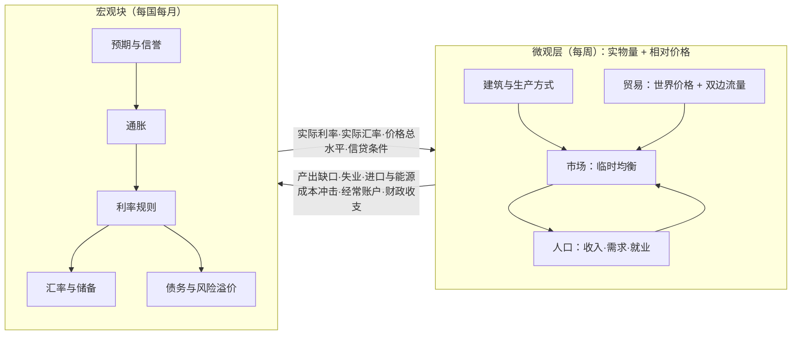

# 经济模型：取舍与设计

> 版本 v0.3。本文回答一个问题：怎样在**直观、好玩、好调**的前提下，尽量多地复现真实的经济学规律。
> 第 5 节的宏观块已经写成代码（`packages/sim/src/macro/`），可以用 `pnpm macro` 运行；第 7 节中标 ✅ 的规律都有对照测试。

---

## 0. 结论先行

**为什么"写微观内核、让宏观自己长出来"很难调？** 根本原因不是参数多，而是**结构**：价格靠试错式的动态调整，容易振荡；正反馈回路没有阻尼；名义价格没有锚，会整体漂移；参数没有经济含义，只能盲调；宏观上最重要的东西（预期、信誉、利率规则）本来就不是简单微观规则的产物。

**我们的取舍，一句话：** 实物和相对价格交给微观模拟，名义变量和经济周期交给宏观方程；规律尽量来自**结构**和**会计恒等式**，而不是来自精细的动态调参。具体是三条：

1. **两层分工。** 微观层（建筑、人口、市场）决定"生产什么、在哪里生产、谁有工作、谁的收入高"，全部以实物量和相对价格计算。宏观块（每国每月一组方程）决定通胀、利率、汇率、债务、信誉。两层只通过少数几个变量耦合。
2. **结构上就稳定。** 价格每回合直接解出，而不是靠试错逼近；所有调整速度用"半衰期"表达；可能发散的响应都有饱和上限；无法保证稳定的更新改为隐式求解。
3. **参数有含义，调参靠工具。** 每个参数都是弹性、份额、半衰期或阈值，带单位和合理范围；每条声称的规律都有自动测试；最后用真实历史数据做自动校准，而不是手工拧旋钮。

**原型已经证明了什么。** 宏观块有 38 个参数（另有需求替身 10 个）、12 个场景，40 条测试全部通过：
- 16 条规律在标定参数下用**对照测试**检验（两次运行只差一个机制），另有 2 条检验量级和稳态（费雪效应、相对购买力平价）；
- 1 条把这 16 条规律放到标定值附近重新检验：每个参数在标定值 ±20% 内随机取值，25 组参数下全部成立；
- 18 条**机制测试**，每条锁住一个机制（例如风险溢价有上限、违约后的市场排斥、债务会计精确守恒）；
- 3 条**数值安全测试**，其中一条在文档范围内抽样全部参数（均匀抽样、只取端点、两者混合三种方式），每个场景跑满 100 年，要求结果有限、有界、没有高频振荡，两次违约的间隔不短于市场排斥期。
- **变异测试**：把模型中的 33 处机制逐一删掉或改坏，32 处会让测试失败；唯一存活的一处见第 10 节。

**承诺的边界。** 整个文档范围内保证**数值安全**；经济规律保证在**标定值附近**成立。在范围的极端组合下（例如风险溢价极陡、利率几乎不调整），某些规律可能不再成立：那是另一种经济，不是数值错误。

第 10 节记录了原型中遇到的问题，以及对抗性审查发现的问题。它们**几乎全部是结构问题，改结构就解决了**，没有一个是靠反复调参数解决的。

## 1. 难调的根源

| 根源 | 表现 | 对策 |
|---|---|---|
| 价格靠试错逼近 | 价格振荡、发散，调整速度稍大就崩 | 每回合直接解出出清价格（临时均衡） |
| 正反馈没有阻尼 | 工资—物价螺旋、通缩螺旋、资本外逃无限放大 | 有界响应 + 半衰期式的部分调整 |
| 名义锚缺失 | 物价总水平随机漂移，通胀无从解释 | 相对价格与价格总水平分离，后者由宏观方程决定 |
| 参数没有含义 | 只能盲调，改一个参数牵动全局 | 每个参数都有单位、范围、经济含义和文献依据 |
| 钱凭空产生或消失 | 长期运行后数值漂移 | 会计恒等式由代码保证，并作为不变量测试（例外见第 8 节） |
| 反馈周期太长 | 要跑几十年才知道哪里错了 | 每个模块可以单独测试；宏观沙盒秒级出结果 |
| 微观规则推不出宏观规律 | 没有预期、信誉、政策规则 | 这些直接写成宏观方程 |

## 2. 设计原则

1. **两层分工**：微观算实物与相对价格，宏观算名义变量与周期。
2. **临时均衡**：每回合在给定供给下直接解出价格；数量调整慢，价格调整快。
3. **半衰期**：所有调整速度都写成"多少个月缩小一半差距"，而不是一个抽象系数。
4. **有锚**：每个变量都有长期锚（正常成本、中性利率、潜在产出、均衡实际汇率），短期是对锚的偏离。
5. **有界响应**：所有可能发散的量都有上下限：资本流动、产出缺口、经常账户、风险溢价、实际汇率偏离、通胀、实际利率对需求的影响；债务超过阈值就违约减记，随后一段时间被市场排斥。上限本身也是有含义的参数。
6. **隐式求解**：资本流动和贸易对汇率的反馈放在同一个单调方程里，每步用二分法解出。参数在文档范围内任意取值、跑满 100 年都不发散、不振荡，这由属性测试验证。
7. **显式冲击**：经济周期的"起因"是显式的随机冲击（就像真正的宏观模型那样），"传导"才交给系统。
8. **会计恒等式由代码保证**：资金、人口、国际收支（固定汇率部分）、债务动态。
9. **每条规律一个对照测试**：两次运行只差一个机制，去掉这个机制测试必须失败（用变异测试验证）；最后用真实数据自动校准。

## 3. 两层结构



耦合变量只有这几个，所以两层可以各自单独测试：

- **微观 → 宏观**：产出缺口（实际产出相对正常开工产出）、失业率、进口与能源相对价格的变化（成本冲击）、经常账户、财政收支。
- **宏观 → 微观**：实际利率（影响储蓄与投资）、实际汇率（影响进出口竞争力）、价格总水平（只用于把实物价值换算成名义数字给玩家看）、信贷条件。

## 4. 微观层（设计，下一阶段实现）

### 4.1 单位与价格归一

- 所有商品有一个**基准价格**（数据中给定），实物量 × 基准价格 = 不变价产出。实际 GDP、产业结构、增长率都以此计算。
- 市场中形成的是**相对价格**。每回合把一国的价格指数归一到 1：微观层只决定"什么东西相对更贵"，价格**总水平**只由宏观块决定。这样通胀不会被重复计算，也不会在微观层随机漂移。
- 一个重要的推论：当总需求不足时，归一后的相对价格不会整体下跌，而是表现为**卖不出去 → 开工率下降 → 产出缺口为负**。这正是凯恩斯式的短期（价格总水平有粘性，数量调整），长期则由相对价格和投资调整（古典式）。

### 4.2 每回合临时均衡

- 回合内**供给是给定的**（本回合产出 + 库存），需求是常弹性函数。出清价格直接解出：

```
p* = p × (需求 / 供给)^(1 / 需求弹性)，再限制在 [基准价 × 0.2, 基准价 × 5] 之内
```

- 价格管制的商品价格固定，缺口通过**配给**（按优先级分配，计划经济里"先保工业还是先保民生"是玩家的选择）体现，部分溢出为黑市。
- 数量调整慢：开工率以约 2 个月的半衰期向盈利目标调整，产能扩张以年计。价格快、数量慢，这本身就保证了稳定。

### 4.3 生产与开工率

- 建筑按生产方式的配方（固定比例）消耗投入、雇用劳动、产出商品。
- 开工率 = min（劳动力满足率，投入满足率）× 盈利调节；长期亏损则降级或关停（国企在软预算约束下可以不关停，由财政兜底）。
- 生产率 = 生产方式 × 技术距离前沿的程度 × 基础设施 × 管理质量 × 集聚效应 × 气候。

### 4.4 需求

- 人口的消费用**线性支出系统**（Stone–Geary）：先满足每个需求类别的"最低量"，剩余收入按边际预算份额分配。参数是"每人最低需要多少"和"多出的钱有多少花在这一类"，都可以用住户调查数据校准；**恩格尔定律**自然出现。
- 类别内部按相对价格替代（常替代弹性）。例如"交通"类别里：自行车、摩托车、燃油车、电动车、公共交通。新增商品只需把它加入某个类别。
- 储蓄率由年龄结构（生命周期）、实际利率、收入和社会保障程度决定。

### 4.5 劳动力与工资

- 劳动力池按"地区 × 受教育层级"划分，高学历可以向下就业。
- 工资有粘性：以约半年的半衰期向"岗位愿意支付的工资"调整，下限是非正规部门收入 × 溢价，以及最低工资。
- 找不到正规工作的人回落到非正规部门，收入由当地土地与人口压力决定——**刘易斯拐点**由此涌现：剩余劳动力被吸收完之前，工资几乎不涨；之后快速上涨。
- 城乡迁移按哈里斯—托达罗模型：期望城市收入 = 城市工资 ×（1 − 城市失业率）。

### 4.6 投资

- 私人投资：预期回报率高于"实际利率 + 风险溢价"的项目获得资金，在候选项目间按回报率做 softmax 分配（一个"资本逐利强度"参数）。
- 国有投资：由玩家或 AI 计划直接分配。
- 建设本身是一个部门，消耗建材、机械和劳动，产能有限——基建热潮会推高建材价格。

### 4.7 贸易

1. **世界价格与净贸易**：每种商品一个世界价格（集团对立时每个贸易圈一个）。国内价格高于"世界价格 ×（1 + 贸易成本）"时进口、低于"世界价格 ×（1 − 贸易成本）"时出口，贸易量以几个月的半衰期向目标调整（**J 曲线**由此产生：贬值后价格立刻变化，数量慢慢跟上）。
2. **双边流量**：用引力模型把出口分配给进口国，权重由距离、关系、协定、制裁决定。双边流量用于计算依赖与筹码。

### 4.8 住房与本地服务

住房和本地服务按地区结算，其余商品按国家市场结算。城市房价由此出现，并影响生育意愿与满意度。

## 5. 宏观块（已实现原型）

每国每月一组方程。利率、通胀、贬值都是连续复利的年化率，所以价格水平和汇率按对数存储，永远不会溢出；命令行显示时换算成普通年率。代码：`packages/sim/src/macro/model.ts`；参数与说明：`pnpm macro --params`。

**汇率制度与资本账户不是枚举，而是数值**：汇率灵活度（0 = 钉住，0.5 = 有管理浮动，1 = 自由浮动）与资本流动性。爬行钉住、货币局这类法律选项只是这些数值的不同组合，加选项只改数据。央行的法律地位同样只决定两件事：是否按规则定利率，以及能达到的基础信誉。

| 步骤 | 方程（文字版） | 对应规律 |
|---|---|---|
| 风险溢价 | （政治风险 + 违约后的声誉溢价）+ 斜率 × max(0, 债务 − 安全债务)² + 斜率 × 储备短缺程度，再经饱和上限；声誉溢价随市场排斥期结束而消退 | 债务风险的凸性、储备与投机攻击、违约的声誉代价 |
| 债务利率 | 本币债务的平均利率以半衰期向（政策利率 + 风险溢价 + 期限溢价）靠近；外币债务按锚货币利率 + 风险溢价计息 | 借新还旧、期限结构 |
| 财政 | 赤字 = 利息 − 基本盈余；印钞 = max(0, 赤字) × 货币化比例。被市场排斥期间，已违约债务的利息计入拖欠，基本赤字只能全部印钞 | 财政主导、违约后的货币化 |
| 信誉 | 目标信誉 = 基础信誉 − 偏离惩罚 × 超出容忍度的"记忆中通胀"偏离 − 印钞惩罚 × 印钞；以半衰期向目标靠近 | 信誉靠过往记录挣来 |
| 货币锚 | 通胀目标 + 印钞额 × 系数 × e^(卡甘半弹性 × 记忆中通胀) | 货币数量论、卡甘货币需求、铸币税上限 |
| 预期 | 信誉 × 货币锚 +（1 − 信誉）× 记忆中通胀 | 预期锚定 |
| 通胀 | 预期 + 斜率 × 产出缺口 + 成本冲击 + 汇率传导，限制在上下限之间 | 预期增强型菲利普斯曲线、滞胀 |
| 汇率传导 | 实际贬值先进入"待传导"存量，按半衰期逐月传到物价 | 汇率传导的滞后 |
| 记忆 | 记忆中通胀以"基础半衰期 ÷（1 + 关注度 × 记忆中通胀）"向实际通胀靠近 | 通胀越高，人们越关注物价 |
| 利率 | 独立央行：预期通胀 + 中性实际利率 + 有界的调整（系数 × 预期通胀偏离 + 系数 × 缺口）；汇率越固定、资本越自由，越要跟随锚货币利率 + 风险溢价；政府控制时由玩家设定 | 泰勒原则、不可能三角 |
| 资本流动 | 上限 × tanh（流动性 ×（利差 − 预期贬值 + 均值回归项）÷ 上限） | 利率平价、突然停止的规模 |
| 汇率 | 浮动部分：在一个单调方程里同时考虑经常账户和资本流动，二分法解出新的实际汇率，并限制在偏离上限内；固定部分：储备承担压力，储备不够的部分记为"特殊融资"（拖欠、紧急贷款），资本流动仍是市场的真实流动；储备低于阈值则钉住崩溃并一次性贬值 | 汇率超调、货币危机、国际收支恒等式 |
| 债务率 | 本币债务与外币债务分开、按精确复利计算：本币债务被通胀稀释，外币债务随贬值重估；外币债务不会为负，超额还款记到本币债务上；超过阈值则违约，减记到阈值以下，并在一段时间内被市场排斥（不能借新债） | r − g 债务动力学、通胀税、货币错配、违约与重组 |

在完整游戏中，产出缺口、成本冲击、经常账户来自微观层；原型里由一个"需求替身"提供（`demand-proxy.ts`）：一条 IS 曲线（私人借贷成本 = 实际利率 + 主权风险溢价，影响有饱和上限；通胀偏离目标有产出代价，偏离小时近似平方、偏离大时近似线性；缺口有饱和上限），加一条有饱和上限的经常账户方程，并告诉汇率求解器经常账户对汇率的局部敏感度。这个替身之后不会删除：顾问和 AI 会用它做快速预测（"如果加息 2 个百分点，预计……"）。

**12 个场景**（`pnpm macro <场景>`）：稳态、财政扩张、石油冲击（预期稳定 / 预期失锚）、反通胀、财政主导、恶性通胀、钉住汇率（资本开放 / 资本管制）、有管理浮动 + 部分开放、钉住汇率遇上衰退、债务螺旋。每个场景的说明文字都是照着实际输出写的。

## 6. 金融周期（设计，下一阶段实现）

- 状态：信贷 / GDP 缺口、资产价格指数（股市与房地产）、杠杆率。
- 资产价格有外推型预期（涨了还会涨），但有界；信贷扩张推高资产价格，资产价格上涨又放松抵押约束——这个正反馈有明确的增益参数，并且小于 1。
- 危机概率 = f（信贷缺口、资产高估、杠杆率）；危机发生时：信心冲击、投资骤降、银行亏损转化为财政成本。
- 宏观审慎、分业经营等法律降低增益与危机概率，代价是平时的增长更慢。

## 7. 经济规律清单

类型：**结构**＝从模型结构中自然产生；**方程**＝写成显式方程；**会计**＝由会计恒等式保证。
状态：✅ 已实现并有测试；◐ 已实现、待补测试；○ 已设计、待实现。

| # | 规律 | 怎么得到 | 类型 | 状态 |
|---|---|---|---|---|
| 1 | 预期增强型菲利普斯曲线 | 通胀 = 预期 + 斜率 × 缺口 | 方程 | ✅ |
| 2 | 泰勒原则 | 信誉相同时，固定名义利率让通胀持续偏高，按规则加息则回到目标 | 方程 | ✅ |
| 3 | 滞胀 | 成本冲击同时推高通胀、压低产出 | 方程 | ✅ |
| 4 | 预期锚定与央行信誉 | 同样的冲击，信誉低的国家通胀更持久 | 方程 | ✅ |
| 5 | 反通胀的代价（牺牲率） | 信誉低时，反通胀损失的产出更多 | 结构 | ✅ |
| 6 | 信誉靠过往记录挣来 | 信誉按记忆中的通胀评估，一个月的好数据不够 | 方程 | ✅ |
| 7 | 费雪效应 | 稳态下名义利率 = 实际利率 + 通胀 | 结构 | ✅ |
| 8 | 相对购买力平价 | 浮动汇率按通胀差漂移 | 方程 | ✅ |
| 9 | 货币数量论（长期） | 印钞越多，通胀平台越高 | 方程 | ✅ |
| 10 | 铸币税上限与恶性通胀 | 卡甘货币需求：超过上限即自我加速 | 方程 | ✅ |
| 11 | 通胀税只稀释本币债务 | 本币债务被通胀稀释，外币债务不会 | 会计 | ✅ |
| 12 | 不可能三角 | 钉住时资本越自由，储备流失越快；汇率越灵活，压力越多地落在汇率上；保卫钉住就不能为衰退降息 | 结构 | ✅ |
| 13 | 国际收支恒等式 | 固定汇率下，储备变化 = 经常账户 + 资本流动 + 特殊融资 | 会计 | ✅ |
| 14 | 货币错配（"原罪"） | 贬值使外币债务立刻膨胀 | 会计 | ✅ |
| 15 | 双赤字 | 财政扩张 → 过热与进口增加 → 经常账户赤字（汇率不动时也成立） | 结构 | ✅ |
| 16 | 储备与投机攻击 | 储备下降推高风险溢价 | 方程 | ✅ |
| 17 | 突然停止的规模 | 资本流动有饱和上限 | 方程 | ✅ |
| 18 | 债务螺旋与违约 | 凸性风险溢价与债务相互推高，最终违约减记；之后一段时间被市场排斥、只能印钞，排斥结束后还要付声誉溢价 | 会计 + 方程 | ✅ |
| 19 | 主权风险外溢 | 私人借贷也要付主权风险溢价，债务危机伴随衰退 | 方程 | ✅ |
| 20 | 汇率传导的滞后 | 贬值分几个月传到物价 | 方程 | ✅ |
| 21 | 高通胀的产出代价 | 恶性通胀最终带来深度衰退 | 方程 | ✅ |
| 22 | 美元化 | 实际汇率偏离达到上限后不再继续扩大 | 方程 | ✅ |
| 23 | 汇率超调 | 市场预期实际汇率回归均衡 | 方程 | ◐ |
| 24 | 第一代货币危机 | 钉住 + 通胀差 → 实际升值 → 储备流失 | 结构 | ◐ |
| 25 | 低利率货币的资本外流与贸易顺差 | 利差决定资本流向，经常账户为其融资 | 结构 | ◐ |
| 26 | 恩格尔定律 | 线性支出系统 | 结构 | ○ |
| 27 | 结构转型（农业 → 工业 → 服务业） | 收入弹性差异 + 生产率增速差异 | 结构 | ○ |
| 28 | 鲍莫尔成本病 | 服务生产率增长慢，而工资跨行业趋同 | 结构 | ○ |
| 29 | 巴拉萨—萨缪尔森效应（富国物价更高） | 不可贸易服务的价格随工资上升 | 结构 | ○ |
| 30 | 比较优势与贸易利得 | 相对成本决定贸易方向 | 结构 | ○ |
| 31 | 贸易引力模型 | 双边流量分配 | 方程 | ○ |
| 32 | J 曲线 | 价格立即变化，贸易量滞后调整 | 结构 | ○ |
| 33 | 刘易斯拐点 | 非正规部门作为劳动力蓄水池 | 结构 | ○ |
| 34 | 哈里斯—托达罗迁移 | 期望收入决定迁移 | 方程 | ○ |
| 35 | 库兹涅茨曲线 | 二元经济转移过程中不平等先升后降 | 结构 | ○ |
| 36 | 索洛收敛与追赶增长 | 资本边际收益递减 + 技术向前沿扩散 | 结构 | ○ |
| 37 | 中等收入陷阱 | 越过拐点后，增长取决于人力资本与创新 | 结构 | ○ |
| 38 | 普雷维什—辛格假说 | 初级产品收入弹性低，贸易条件恶化 | 结构 | ○ |
| 39 | 荷兰病 | 资源出口 → 实际升值 → 制造业萎缩 | 结构 | ○ |
| 40 | 资源诅咒（政治） | 租金减少对税收的依赖，削弱问责 | 方程 | ○ |
| 41 | 价格管制导致短缺与黑市 | 固定价格下的配给 | 方程 | ○ |
| 42 | 软预算约束 | 国企亏损由财政兜底 | 方程 | ○ |
| 43 | 计划的信息问题 | 计划效率随经济复杂度下降 | 方程 | ○ |
| 44 | 学习曲线（莱特定律） | 新技术成本随累计产量下降 | 方程 | ○ |
| 45 | 资源枯竭与勘探 | 储量、发现与开采成本 | 方程 | ○ |
| 46 | 拉弗曲线 | 税率越高，逃税与非正规化越多 | 方程 + 结构 | ○ |
| 47 | 奥肯定律 | 开工率与就业同向变化 | 结构 | ○ |
| 48 | 生命周期储蓄与人口红利 | 储蓄率随年龄结构变化 | 方程 | ○ |
| 49 | 人口转型 | 死亡率先降、生育率后降 | 方程 | ○ |
| 50 | 财政乘数与节俭悖论 | 需求不足时数量调整 | 结构 | ○ |
| 51 | 金融周期与"明斯基时刻" | 信贷—资产价格的有界正反馈 | 方程 | ○ |
| 52 | 外部性与庇古税 | 污染与碳排放的社会成本 | 方程 | ○ |
| 53 | 公地悲剧（气候） | 全球碳存量，单国减排收益外溢 | 方程 | ○ |
| 54 | 特里芬难题 | 储备货币国必须向世界提供流动性 | 结构 | ○ |

## 8. 我们放弃了什么

明确写下来，免得以后反复纠结：

- **不做单个企业、单个家庭的最优化**；人口与建筑都是群体。
- **通胀不从微观价格中涌现**，由宏观方程给出。换来的是稳定、可解释、可调。
- **经济周期的起因是显式冲击**，传导才由系统完成（这和真实的宏观模型做法一致）。
- **不做完整的一般均衡求解**：每回合临时均衡 + 慢变量调整。
- **金融体系高度简化**：没有单个银行，只有部门层面的信贷与资产价格。
- **预期不是完全理性的**：信誉 + 适应性记忆的组合，足够产生上面的规律，也让玩家看得懂。
- **违约与货币危机目前自动处理**：违约直接减记并触发一段市场排斥，钉住崩溃直接转为浮动。在游戏里它们会变成有选择、有代价的事件（例如重组谈判、国际救助）。
- **浮动汇率下的国际收支是逐月出清，而不是恒等式**：汇率按不平衡的大小移动，不会一步到位，所以某个月的经常账户 + 资本流动不一定为零，差额视为私人部门的短期融资，没有单独记账。微观层接入后经常账户来自真实贸易，届时再决定是否显式记账。
- **钉住汇率下储备可以无限积累**：顺差国冲销外汇流入的成本还没有建模。
- **随机参数下，"稳态"场景也常常违约**：财政政策固定时，只要利率高于增长率（r > g），债务必然发散。这是正确的经济学，不是数值错误；所以属性测试只检查数值安全，规律测试只在标定值附近进行。
- **跨引擎的浮点一致性**：`Math.exp`、`Math.tanh` 在不同 JavaScript 引擎上可能有最后一位的差异。目前 Node 与 Electron 都是 V8，结果一致；如果将来要在其他引擎上回放，再自带这些函数的实现。

## 9. 调参与校准工具链

1. **参数表**：每个参数有含义、单位、范围（`pnpm macro --params`）；超出范围直接报错。
2. **宏观沙盒**：`pnpm macro <场景> --set 参数=值`，不改代码就能换参数，秒级看到逐年的表格（`--monthly` 看逐月）。
3. **对照测试与属性测试**：每条规律一个对照测试，调参后跑 `pnpm test`，立刻知道哪条规律被破坏了；属性测试保证整个参数范围都是数值安全的，所以调参时不用担心把模型调崩。
4. **历史校准**（真实世界开局之后）：把真实数据的统计特征当作目标，例如各国通胀的均值与波动、利率与通胀的关系、债务路径、人口与城市化轨迹、产业结构变化；用随机搜索或 CMA-ES 在 CPU 多核上并行跑无头模拟，自动寻找参数。
5. **敏感度报告**：自动列出"哪个参数对哪个结果影响最大"，调参时只需关注少数几个。

## 10. 原型中遇到的问题

这一节值得单独记下，因为它说明了**大多数"调参困难"其实是结构问题**：

| # | 现象 | 根源 | 修正（结构，不是调参） |
|---|---|---|---|
| 1 | 财政扩张时通胀反而下降；预期失锚时通胀冲到 5000%、汇率变成无穷大 | 浮动汇率缺少"会回归均衡"的预期，资本流动和贬值无限放大 | 加入实际汇率均值回归预期（汇率超调模型） |
| 2 | 参数稍大时汇率来回振荡 | 显式更新在增益大于 1 时不稳定 | 改为隐式求解（二分法）；整个参数范围内的稳定性由属性测试验证 |
| 3 | 恶性通胀时资本外逃达到 GDP 的 1600%，经济"过热" 45% | 线性响应在极端情况下失效 | 资本流动与产出缺口加饱和上限 |
| 4 | 温和印钞时通胀一直爬升、不收敛 | 汇率传导重复计算了"按通胀差贬值"的部分 | 只有**实际**贬值（进口品相对变贵）才传导到通胀 |
| 5 | 从 13% 反通胀到 3%，几乎不付出产出代价 | 信誉按当月通胀评估，一降就回升；利率规则跟着当月通胀走 | 信誉按"记忆中的通胀"评估；利率规则直接设定实际利率 |

问题 4 是"规律测试"发现的：测试要求"财政主导下通胀停在一个平台上"，而实际结果一直在爬升。所以测试不只是防止回退，也是发现模型错误的工具。

### 对抗性审查发现的问题

原型完成后，独立的审查子代理用随机参数扫描、变异测试和延长运行去证伪，找到了下面这些问题，全部已修正：

| 发现 | 根源 | 修正 |
|---|---|---|
| 在参数文档范围内随机抽样，25.8% 的运行出现 NaN 或无穷大；默认参数跑到 17—19 年也会出事 | 汇率与贸易之间是显式的滞后反馈；若干量没有上限 | 贸易反馈并入汇率的隐式方程；所有可能发散的量加上下限；收紧不现实的参数范围；加入"随机参数 × 百年"的属性测试 |
| 债务风险溢价没有上限，债务在有限时间内爆炸 | 溢价与债务平方成正比，利息与债务立方成正比 | 溢价饱和；超过阈值违约并减记 |
| 价格水平会溢出 | 对数率与水平值混用 | 价格水平、汇率按对数存储，显示时换算 |
| 某些参数下通胀每月来回跳（周期为 2 的振荡） | 利率规则对当月通胀反应，而当月通胀包含上月汇率变动一次性的传导 | 利率规则对预期通胀反应；汇率传导按半衰期分摊 |
| 外币债务也被通胀"稀释" | 外币债务占比被当作常数 | 本币、外币债务分开记账，按精确复利计算 |
| 两条规律测试测的不是它声称的机制 | 测试同时改变了两个因素 | 改为只差一个机制的对照测试，并用变异测试验证 |
| 储备在 0 处截断，破坏国际收支恒等式 | 储备不足时外流仍然记账 | 储备不足时实际外流被截断；增加恒等式测试 |
| 静态分析器遇到 JSDoc 会崩溃，也有漏报和误报 | 节点定位与读写判定过于简单 | 修正定位；`++`、`+=` 视为写入；只为更新自身而读取不算读取；检查普通对象常量；转发规则覆盖更多写法，并跳过默认参数和实现接口的方法 |
| 一批代码路径从未被任何场景用到 | 先写了机制，没写用到它的场景 | 新增"有管理浮动 + 部分开放""钉住汇率遇上衰退"两个场景及测试 |
| 确定性规则可以被绕过 | 只禁止了少数写法 | 禁用 Date、performance、crypto、process、globalThis 等全局量；内容 ID 规则覆盖模板字符串 |
| 汇率制度、资本账户写死成枚举，违反"加法律只改数据" | 类型设计 | 改为数值参数（汇率灵活度、资本流动性） |

这一轮再次说明：难调的根源几乎都是结构，而不是参数取值。

**第二轮审查**（Opus，max effort）专门找属性测试抽不到的参数组合，以及测试没有锁住的机制：

| 发现 | 根源 | 修正 |
|---|---|---|
| 参数取在范围端点附近时，通胀每月来回跳 | 均匀抽样几乎抽不到端点组合；利率、传导半衰期允许短到半个月，规则系数允许很大 | 收紧范围（利率与传导半衰期 ≥ 1 个月、缺口系数 ≤ 1.5 等）；实际利率对需求的影响加饱和上限；通胀的产出代价改为 log-cosh（偏离大时近似线性）；属性测试增加"只取端点"和"混合"两种抽样 |
| 违约之后很快再次违约，反复"抖动" | 减记之后照样借新债，债务很快又超过阈值 | 违约后一段时间被市场排斥（不能借新债），并付声誉溢价；属性测试要求两次违约的间隔不短于排斥期 |
| 违约之后出现恶性通胀 | 排斥期间连利息也印钞 | 已违约债务的利息计入拖欠，只印基本赤字 |
| 违约之后资本反而流入 | 减记让债务率下降，风险溢价跟着下降 | 声誉溢价：刚违约的国家要付更高的溢价，随排斥期结束而消退 |
| 储备耗尽时出现"虚假的资本流入"，超过资本流动上限 | 储备不够的部分被记成资本流动 | 单独记为"特殊融资缺口"；资本流动保持有界 |
| 外币债务在 0 处截断时，债务凭空消失 | 截断的部分没有记到别处 | 超额还款精确地记到本币债务上；用 500 组随机状态检验债务会计精确守恒 |
| 参数范围互相矛盾（例如安全债务可以高于违约阈值） | 各参数单独定范围 | 相关参数的范围改为互不重叠 |
| 政策数值没有校验 | 只校验了参数 | 政策数值同样有范围，运行前和每次政策变化后都校验 |
| 命令行 `--set` 能设置原型链上的名字 | 用 `in` 判断参数是否存在 | 改用 `Object.hasOwn` |
| 场景里有两个从来不起作用的字段 | 初始缺口、基准经常账户可以由模型推导 | 删除，改为由模型推导 |
| 文档声称规律在整个参数范围内成立，但随机参数下货币数量论只在 7% 的运行中成立 | 承诺范围写错了 | 明确承诺边界：整个范围保证数值安全，规律在标定值 ±20% 内成立，并对此测试 |
| 46 个变异中有 8 个存活（风险溢价上限、规则调整上限、规则对当月通胀反应、外债付风险溢价、印钞的信誉代价、外币借款比例、浮动汇率不动用储备、储备耗尽时的处理） | 规律测试太宏观，锁不住单个机制 | 每个机制补一条机制测试 |
| 确定性规则仍可绕过（导入 Node 内置模块、把 Math 赋给变量、Reflect） | 只禁止了全局名字 | 禁止导入 Node 内置模块和动态 `import()`；禁止给 Math 起别名、解构或用计算属性访问；禁用 Reflect、eval、Function、定时器、WeakRef 等 |
| 静态分析：绑定 `this` 的箭头函数被误报，`await`、`void` 包着的转发漏报；类只要实现了接口，所有方法都被豁免 | 规则过粗 | 绑定 `this` 的箭头函数豁免；去掉 `await`、`void` 再判断；只豁免基类或接口要求的成员 |

修正之后重新做变异测试：33 个变异中 32 个被测试抓住。唯一存活的是"把通胀产出代价的 log-cosh 换回平方"：在现有范围内两者的稳定性没有差别（各做 4320 次百年运行，都没有振荡），所以 log-cosh 不是稳定性所必需的；保留它是因为它更好解释——偏离越大，每多一个百分点的代价不会无限增加。这不是一条声称的规律，所以没有为它写测试。

## 11. 把规律变成玩法

- **经济规律图鉴**：玩家第一次亲身经历某条规律时（例如本币贬值后出现 J 曲线、越过刘易斯拐点、遭遇荷兰病），解锁一条图鉴，用他自己国家的数据画出曲线并解释原因。既好玩，也让玩家看懂系统。
- **顾问团**：不同学派的顾问用需求替身做快速预测，给出互相矛盾的建议和置信区间。
- **危机是戏剧时刻**：货币危机、债务违约、恶性通胀都表现为有选择、有代价的事件，而不是数字悄悄变坏。
